# ImKit

**Dear ImGui向けの、テーマ、部品、編集画面のライブラリ**

ImKitは、既存のDear ImGuiアプリに、現代的な見た目と使いやすい部品を足すC++20の静的ライブラリです。テーマを1つ足すだけで始められ、フレームのループは変えません。必要なモジュールだけをリンクできます。

[動画を見る](https://aokimotohide.github.io/imgui-modern-kit/#film) · [ダウンロード](https://github.com/AokiMotohide/imgui-modern-kit/releases/latest) · [マニュアル](https://aokimotohide.github.io/imgui-modern-kit/) · [API参照](https://aokimotohide.github.io/imgui-modern-kit/api/) · [English](README.md)

[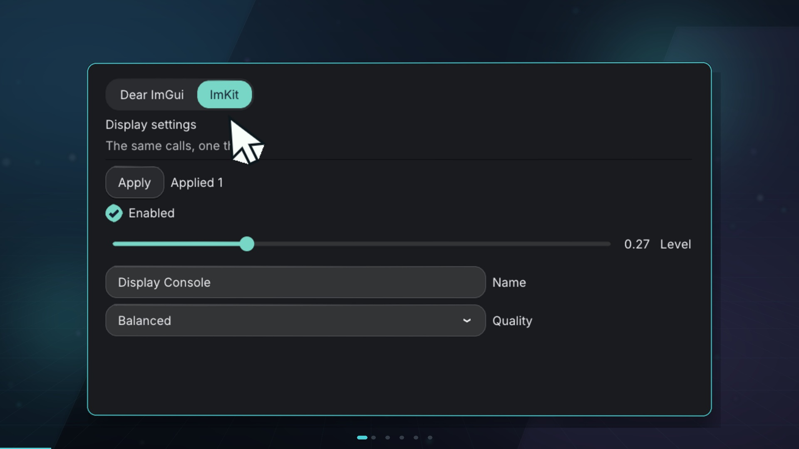](https://aokimotohide.github.io/imgui-modern-kit/#film)

## 概要

- **呼び出しは同じまま、見た目を変える。** テーマを足すと、角丸、やわらかい影、短い遷移の動きが入ります。呼び出しの形も、値の持ち方もそのままです。
- **独自の見た目を作れる。** 4色からテーマを作り、4層基盤（`PartOverrides`、型付き `StyleScope`、`Skin`、`Interact`）で22部品を自在に調整できます。4.1形状へ戻せる `Classic` を含め、14種のテーマを内蔵しています。
- **基本の部品に加えて。** 作業画面の部品、タイムライン、ノードエディタ、グラフ、PTZパッド、321個のアイコンがあります。メディアサーバー向けの任意モジュール `show` もあります。
- **制御はアプリに残る。** Dear ImGuiのContext、バックエンド、レンダラー、フォント、データ、Undo履歴、保存処理は、これまでどおりアプリが持ちます。

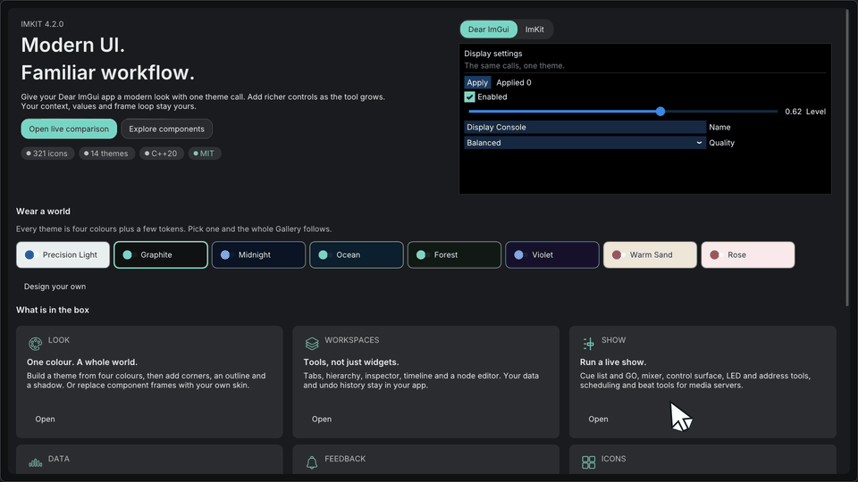

## Galleryで試す

お使いの環境向けの[v4.2.0パッケージ](https://github.com/AokiMotohide/imgui-modern-kit/releases/tag/v4.2.0)をダウンロードして展開し、`bin/imkit_gallery.exe`（Windows）または `imkit_gallery.app`（macOS）を起動してください。Node Editor専用のGalleryも入っています。Galleryは、アプリがリンクするのと同じ公開部品だけで作ってあります。

Windowsでソースからビルドする場合は、次のとおりです。

```
cmake --preset windows-debug
cmake --build --preset windows-debug --target imkit_gallery --parallel
./build/windows-debug/catalog/Debug/imkit_gallery.exe
```

## 既存アプリへ組み込む

アプリがすでに使っているDear ImGuiのターゲットを、ImKitに教えます。

```cmake
set(IMKIT_IMGUI_TARGET host_imgui)
add_subdirectory(external/imgui-modern-kit)
target_link_libraries(your_app PRIVATE imkit::imkit)
```

フレームを始める前にテーマを適用し、ふつうのウィンドウの中で部品を呼びます。

```cpp
#include <imkit/imkit.h>

auto theme = imkit::MakeTheme(imkit::ThemePreset::Ocean);
imkit::ApplyTheme(theme, 1.0f); // ImGui::NewFrame() より前

if (imkit::Begin("Display")) {
    static bool enabled = true;
    imkit::Toggle("Enabled", &enabled);
    imkit::ActionButton("Apply", imkit::ActionVariant::Primary);
}
imkit::End();
```

## 作れるもの

| 分野 | 使える部品 | CMakeターゲット | Galleryの画面 |
| --- | --- | --- | --- |
| 見た目 | テーマ、ブランド色、スキン、321個のアイコン | `imkit::imkit` | Theme Studio、Skins、Icons |
| 基本部品 | ボタン、トグル、スライダー、入力、表、トースト、進捗 | `imkit::imkit` | Controls |
| データ | ドーナツ・棒・ゲージ・スパークラインのグラフ、PTZ操作 | `imkit::imkit` | Data |
| 作業画面 | タイムライン、曲線、インスペクター、階層、プレビューモニター | `imkit::editor_suite` | Workspaces |
| ノードグラフ | キャンバス、ソケット、ミニマップ、編集要求 | `imkit::node_editor` | Node Editor Gallery |
| ショー | キューリスト、ミキサー、コントロールサーフェス、LED、スケジュール | `imkit::show` | Show |
| ネイティブ連携 | ウィンドウ枠、OpenGL／Metalのプレビュー、アクセシビリティ連携 | `imkit::window_frame_*`、`imkit::preview_*` | Window frame |

分野ごとの公開ヘッダー、ターゲット、フレーム内で呼ぶ位置は、[実例とレシピ](docs/getting-started/実例とレシピ.md)にまとめてあります。

## 動きを見る

| | |
| --- | --- |
| 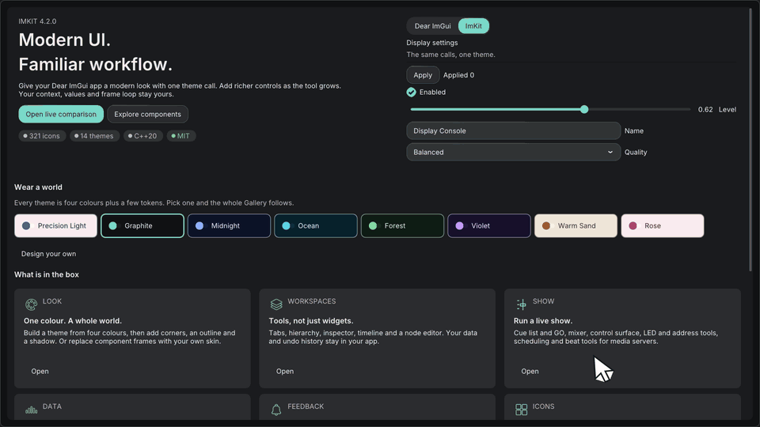<br>テーマを選ぶと、画面全体が着替えます。 | 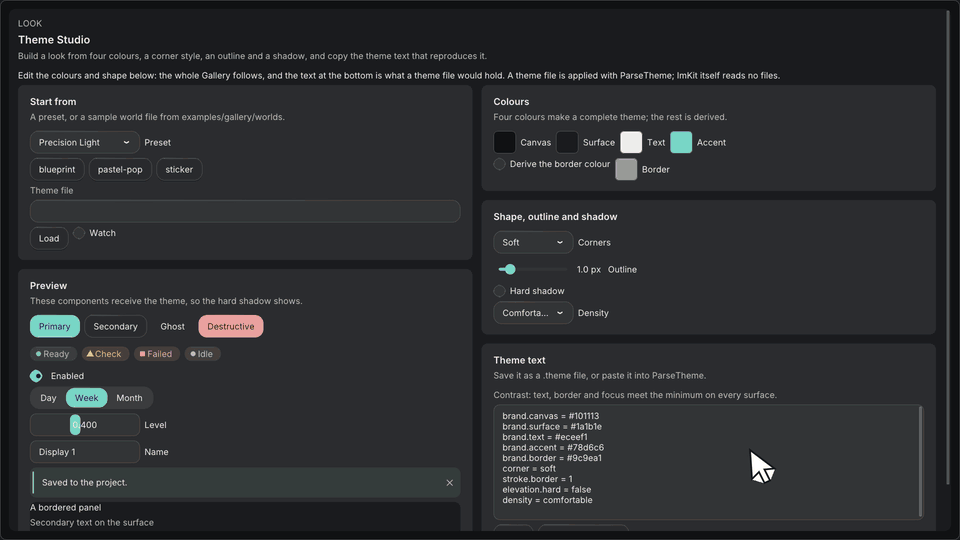<br>見た目を丸ごと読み込み、角と影も変えられます。 |
| 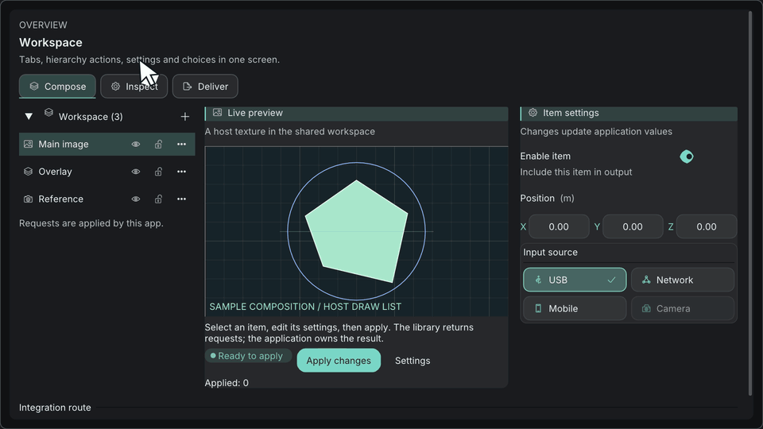<br>タブ、階層、設定を1画面に。 | 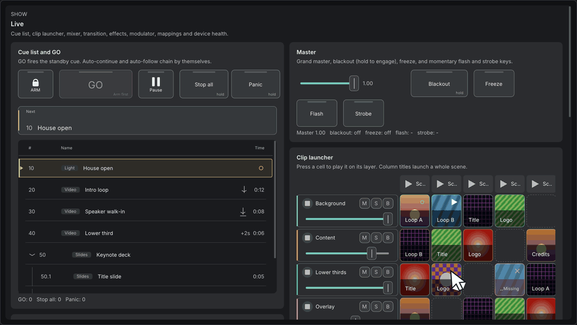<br>GOでライブ演出を動かします。 |
| 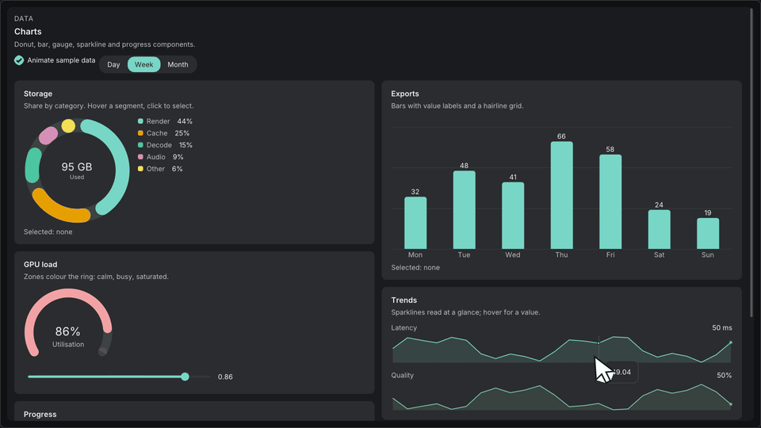<br>ドーナツ、棒、ゲージ、スパークラインのグラフです。 | 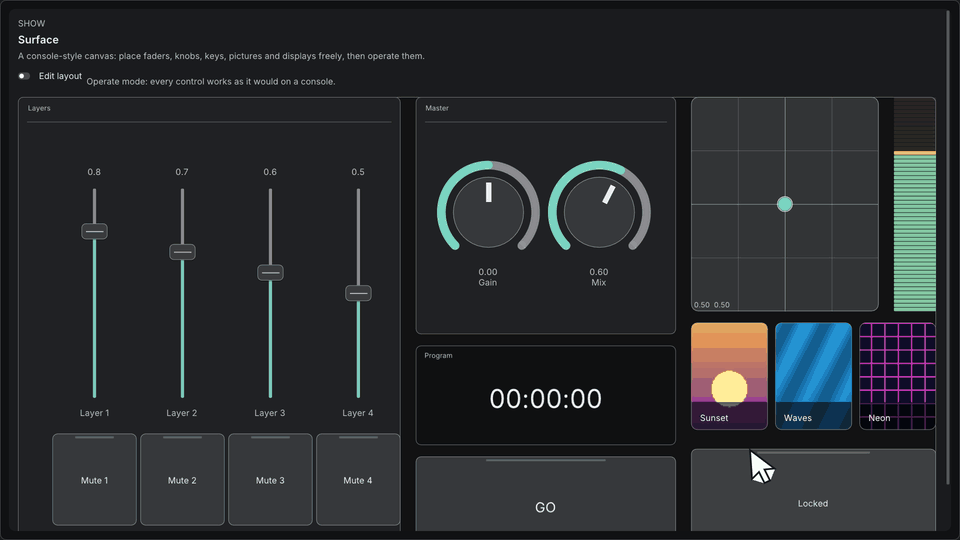<br>フェーダー、ノブ、キーを、卓のように並べられます。 |

## 4.2の新機能

- **4層カスタマイズ基盤と22部品の刷新:** 連続曲率の滑らかな角丸で22個の標準部品を刷新。テーマテキスト（L1 `PartOverrides`）、型付きスタイル・`StyleScope`（L2）、`Skin`（L3）、`Interact()`（L4）、ライブ `ShowStyleEditor`、および4.1の標準形状へ戻せる `ThemePreset::Classic`（計14テーマ）を追加。
- **OKLCH サーフェスゾーンとウィンドウ役割色:** `Inspector`・`Header`・`ChromeCanvas` の均等な明度段差、ドッキングした窓ごとの役割色 `WindowRole` / `DockTabBand`、浮いた道具窓 `PushFloatingPanel` を導入。
- **グロー枠と AI / エージェント外部制御表示:** `DrawGlowFrame` と `ExternalControlIndicator` が遠隔操作・自動化セッション中にビューポート外周を光らせ、背景映像の上でもくっきり読める操作ピルを表示。
- **ワークフロー・曲線・タイムライン・独立モーション:** `StepBand`、`WaitCard`、`SliderFloatWithInput`、`TransferCurveEditor` / `TransferCurveSectionEditor`、`ClipBody::Filmstrip`、Dear ImGui 非依存の `imkit::motion`。

| | |
| --- | --- |
| 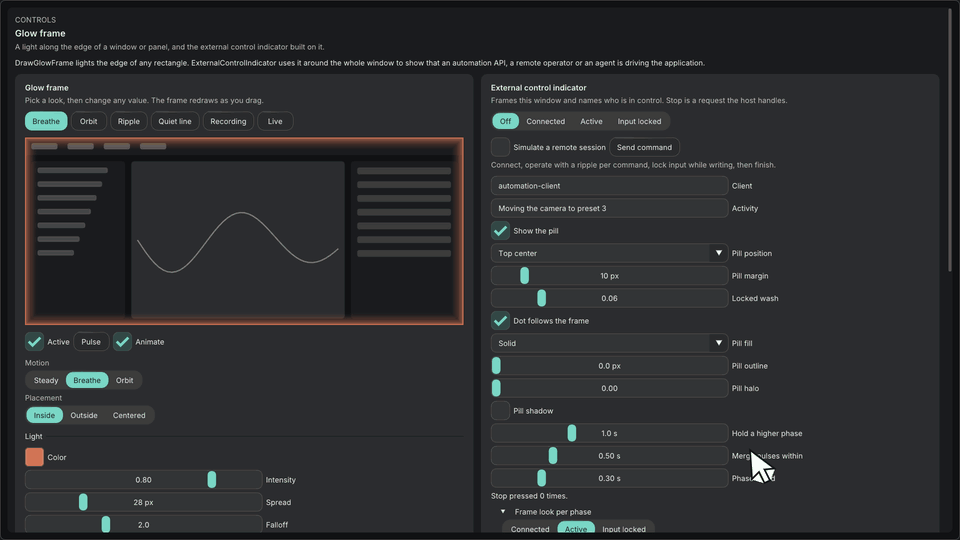<br>グロー枠と外部・AI制御インジケーター。 | 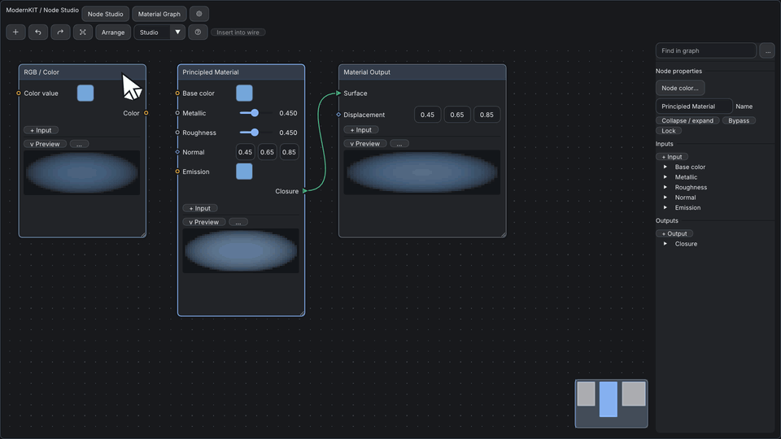<br>ひと目で読めるノードエディタ。 |
| 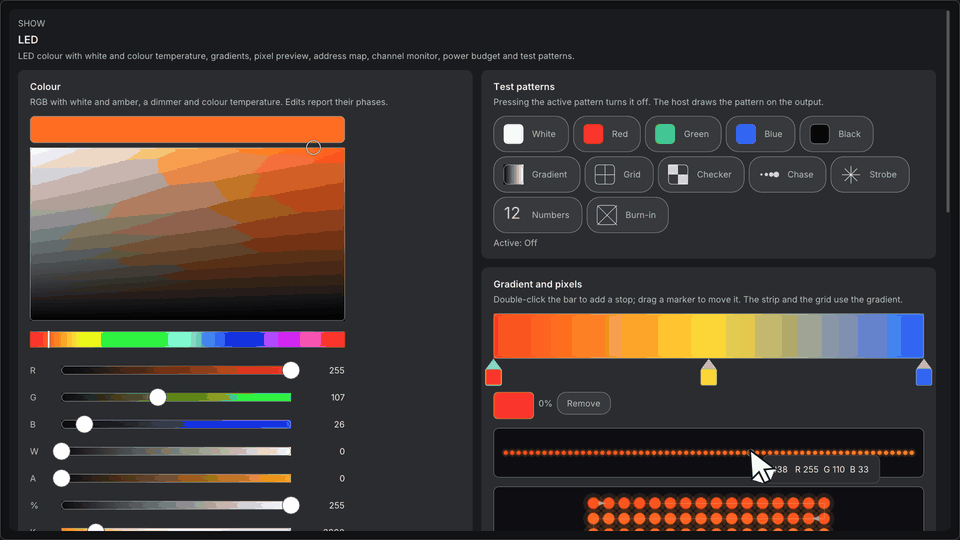<br>LEDウォールを、ポートごとに色分けしたタイルマップで。 | 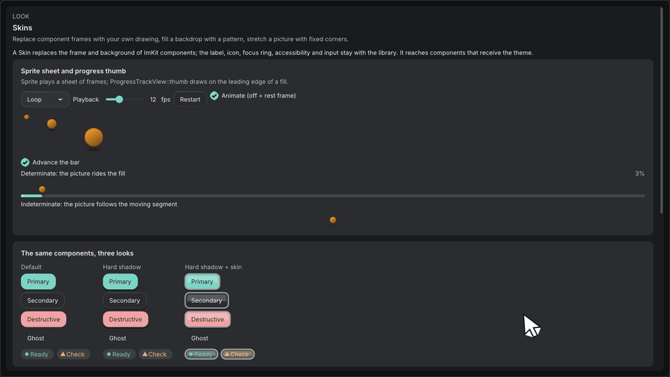<br>スプライトと、進捗バーに乗る絵。 |

アプリと、リンクするすべてのImKitライブラリを、4.2のヘッダーで再ビルドしてください（2件の破壊的変更：`DrawPlateMark` の `PlateMarkDecor` 化、`CornerStyle::Pill` の削除があります）。[移行ガイド](docs/reference/v4移行ガイド.md#41から42へ)、[4.2追加API](docs/reference/4.2追加API.md)、[変更履歴](CHANGELOG.md)を確認してください。4.1では刷新されたノードエディタ、`TileMap`、レイアウトトークン、`Sprite` が加わり、4.0ではブランドテーマ、グラフ、PTZ、`show` モジュールが加わりました。

## 互換性

v4のABIは、Dear ImGui 1.93.0 WIP docking（コミット `367b2c24f399988ddafc0bb4628da0106bcc09be`）を対象にしています。リリースパッケージは、Windows x64とArm64、macOS arm64、x86_64、Universal 2です。macOS版は署名も公証もしていません。自動検査では、実機の入力、ネイティブIME、スクリーンリーダー、複数DPI、他社ホストでの動作は確かめていません。範囲は[検証の範囲](docs/reference/検証記録.md)と[依存関係](docs/architecture/依存関係.md)を参照してください。

## 文書

[文書一覧](docs/目次.md) · [導入ガイド](docs/getting-started/導入ガイド.md) · [部品の使い方](docs/getting-started/利用ガイド.md) · [Galleryガイド](docs/getting-started/ギャラリーガイド.md) · [ノードエディタ](docs/components/ノードエディタ.md) · [アーキテクチャ](docs/architecture/アーキテクチャ.md) · [変更履歴](CHANGELOG.md)

## 謝辞

**ImKitは[Dear ImGui](https://github.com/ocornut/imgui)の上に成り立っています。** C++でツールのUIを手早く、気持ちよく作れるライブラリを作り、育ててくださっているOmar Cornut氏と、すべての貢献者、スポンサーの皆さまに、心から感謝します。ImKitはその成果の上に重ねる層であり、Dear ImGuiの代わりになるものではありません。

- ImKitの公開ヘッダー（`include/imkit/`）が使うのはDear ImGuiの公開APIだけで、フォークもパッチも行いません。内部`.cpp`実装は固定した上流`docking`リビジョンの`imgui_internal.h`を参照します（DLLビルドのホスト向けに`ImGui::GetCurrentContext()`経由で解決します）。Dear ImGuiのソースは無改変のままアプリが用意します。
- Dear ImGuiはMITライセンス（著作権はOmar Cornut氏）です。Galleryのウィンドウには[GLFW](https://www.glfw.org/)を使い、任意のフォントとして[Inter](https://rsms.me/inter/)と[Noto Sans JP](https://github.com/notofonts/noto-cjk)を同梱しています。ライセンスとハッシュは[THIRD_PARTY_NOTICES.md](THIRD_PARTY_NOTICES.md)にあります。
- 設計の参考にしたプロジェクトも、同じ文書に挙げています。そこからコードや素材は取り込んでいません。

## ライセンス

ImKitはMITライセンスです。Dear ImGui、GLFW、任意のフォントは、それぞれのライセンスを保ちます。紹介動画の音楽は `tools/media/music.py` によるオリジナル96小節（128 BPM）スコア、日英ナレーションはGemini Flash TTSを用いて制作され、リポジトリのMITライセンスのもと公開しています（`website/public/media/provenance.json`）。リビジョン、ハッシュ、通知は[THIRD_PARTY_NOTICES.md](THIRD_PARTY_NOTICES.md)にあります。
