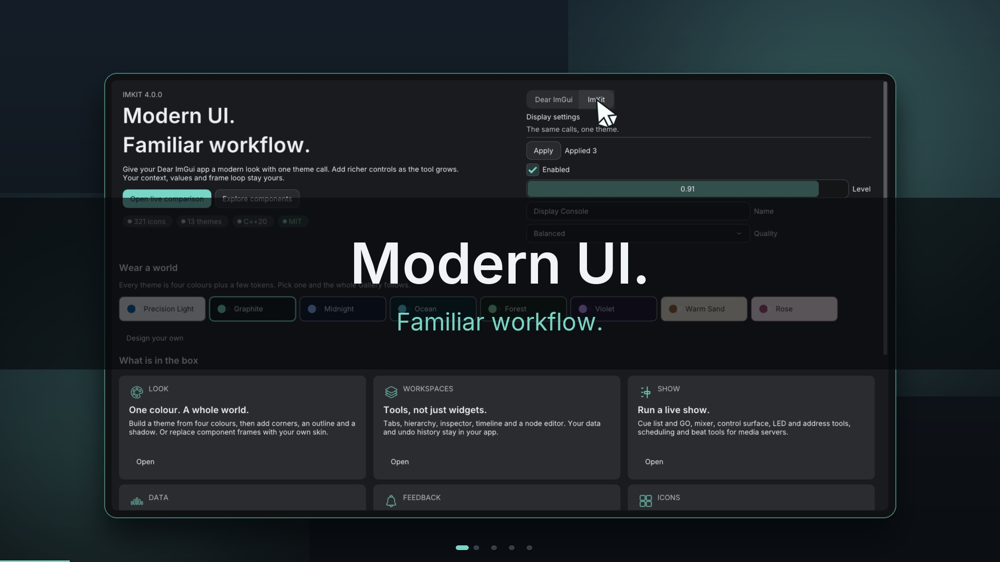
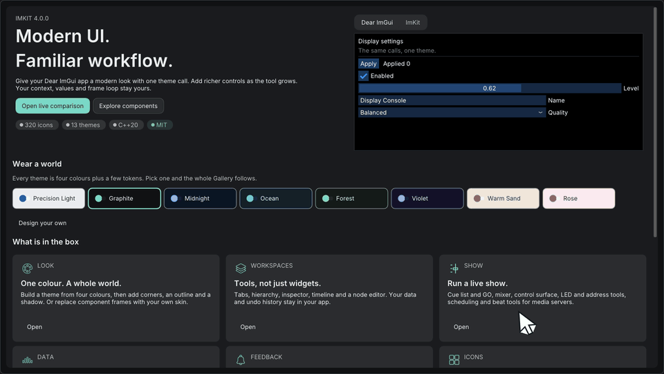
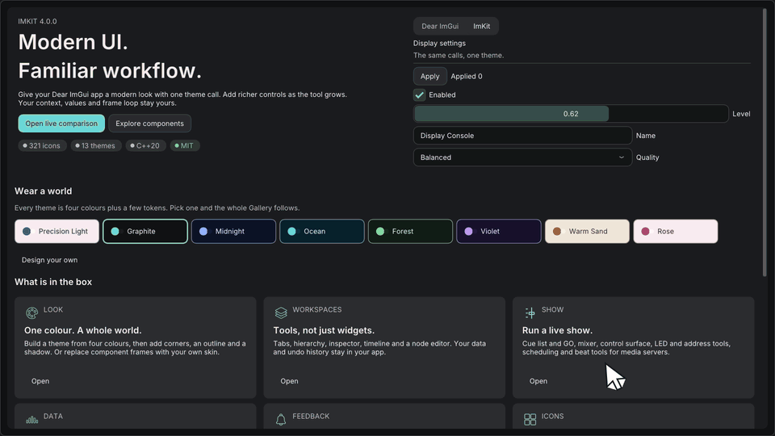
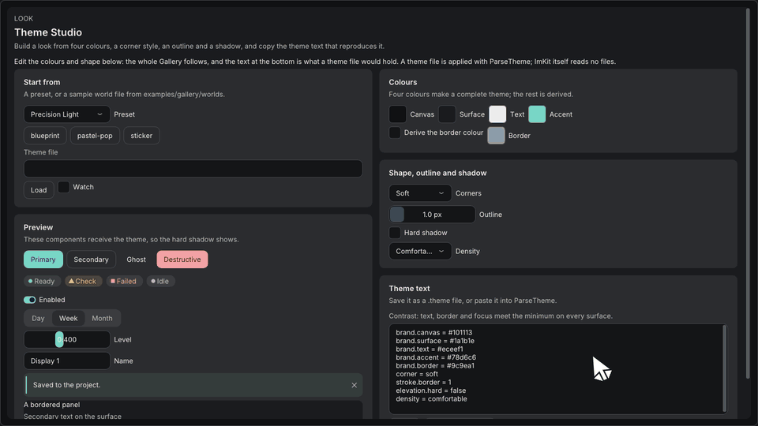
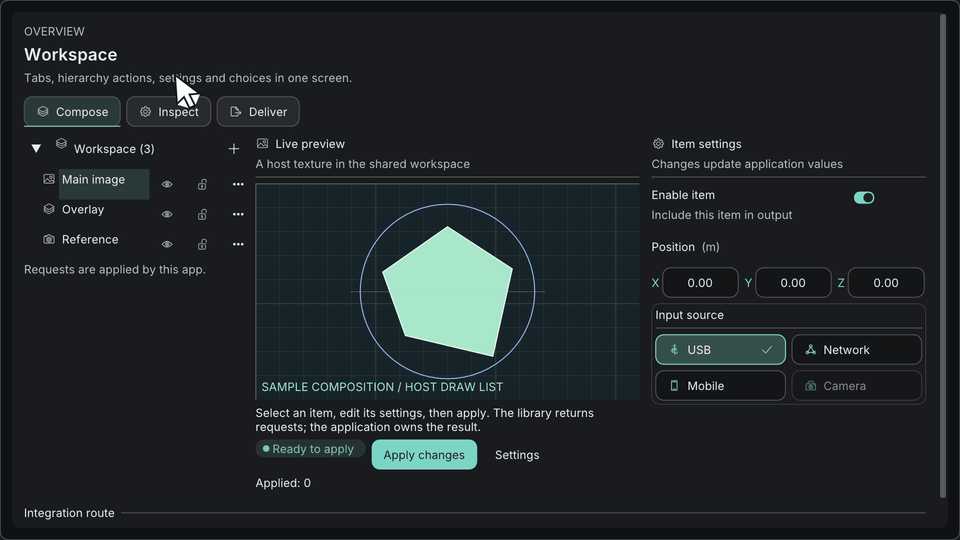
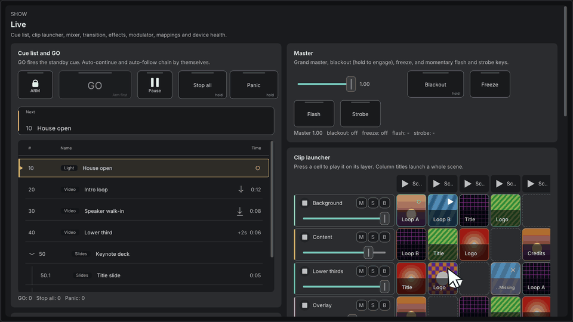

# ImKit

**Dear ImGuiのまま、現代的なUIへ。使い方は、いつもどおり。**

ImKitは、既存のDear ImGuiアプリに、現代的な見た目と使いやすい部品を足すC++20の静的ライブラリです。テーマを1つ足すだけで始められ、フレームのループは変えません。必要なモジュールだけをリンクできます。

[動画を見る](https://aokimotohide.github.io/imgui-modern-kit/#film) · [ダウンロード](https://github.com/AokiMotohide/imgui-modern-kit/releases/latest) · [マニュアル](https://aokimotohide.github.io/imgui-modern-kit/) · [API参照](https://aokimotohide.github.io/imgui-modern-kit/api/) · [English](README.md)

[](https://aokimotohide.github.io/imgui-modern-kit/#film)

## ImKitでできること

- **見た目だけが新しくなる。** テーマを足すと、角丸、やわらかい影、なめらかな動きが入ります。呼び出しの形も、値の持ち方もそのままです。
- **自分の世界観にできる。** 4色からテーマを作り、角、枠線、影を足せます。部品の枠を自作のスキンに差し替えることもできます。テーマは13種を内蔵しています。
- **部品が揃っている。** 作業画面、タイムライン、ノードエディタ、グラフ、PTZパッド、321個のアイコン。メディアサーバー向けの任意モジュール `show` もあります。
- **アプリの作りは変わらない。** Dear ImGuiのコンテキスト、バックエンド、レンダラー、フォント、データ、Undo履歴、保存処理は、これまでどおりアプリが持ちます。



## Galleryで試す

お使いの環境向けの[v4.0.0パッケージ](https://github.com/AokiMotohide/imgui-modern-kit/releases/tag/v4.0.0)をダウンロードして展開し、`bin/imkit_gallery.exe`（Windows）または `imkit_gallery.app`（macOS）を起動してください。Node Editor専用のGalleryも入っています。Galleryは、アプリがリンクするのと同じ公開部品だけで作ってあります。

Windowsでソースからビルドする場合は、次のとおりです。

```
cmake --preset windows-debug
cmake --build --preset windows-debug --target imkit_gallery --parallel
./build/windows-debug/catalog/Debug/imkit_gallery.exe
```

## 既存アプリへ組み込む

アプリがすでに使っているDear ImGuiのターゲットを、ImKitに教えます。

```cmake
set(IMKIT_IMGUI_TARGET host_imgui)
add_subdirectory(external/imgui-modern-kit)
target_link_libraries(your_app PRIVATE imkit::imkit)
```

フレームを始める前にテーマを適用し、ふつうのウィンドウの中で部品を呼びます。

```cpp
#include <imkit/imkit.h>

auto theme = imkit::MakeTheme(imkit::ThemePreset::Ocean);
imkit::ApplyTheme(theme, 1.0f); // ImGui::NewFrame() より前

if (imkit::Begin("Display")) {
    static bool enabled = true;
    imkit::Toggle("Enabled", &enabled);
    imkit::ActionButton("Apply", imkit::ActionVariant::Primary);
}
imkit::End();
```

## 作れるもの

| 分野 | 使える部品 | CMakeターゲット | Galleryの画面 |
| --- | --- | --- | --- |
| 見た目 | テーマ、ブランド色、スキン、321個のアイコン | `imkit::imkit` | Theme Studio、Skins、Icons |
| 基本部品 | ボタン、トグル、スライダー、入力、表、トースト、進捗 | `imkit::imkit` | Controls |
| データ | ドーナツ・棒・ゲージ・スパークラインのグラフ、PTZ操作 | `imkit::imkit` | Data |
| 作業画面 | タイムライン、曲線、インスペクター、階層、プレビューモニター | `imkit::editor_suite` | Workspaces |
| ノードグラフ | キャンバス、ソケット、ミニマップ、編集要求 | `imkit::node_editor` | Node Editor Gallery |
| ショー | キューリスト、ミキサー、コントロールサーフェス、LED、スケジュール | `imkit::show` | Show |
| ネイティブ連携 | ウィンドウ枠、OpenGL／Metalのプレビュー、アクセシビリティ連携 | `imkit::window_frame_*`、`imkit::preview_*` | Window frame |

分野ごとの公開ヘッダー、ターゲット、フレーム内で呼ぶ位置は、[実例とレシピ](docs/getting-started/実例とレシピ.md)にまとめてあります。

## 動きを見る

| | |
| --- | --- |
| <br>テーマを選ぶと、画面全体が着替えます。 | <br>見た目を丸ごと読み込み、角と影も変えられます。 |
| <br>タブ、階層、設定を1画面に。 | <br>GOでライブ演出を動かします。 |

## 4.0の新機能

- 既定の見た目を刷新しました。角丸、影、動きのトークンを見直し、ピル形のセグメントとスライダー、描き直した進捗・トースト・グラフが入ります。
- ブランドテーマ。`MakeBrandTheme`、Theme Studio、スキン、枠線、硬い影を追加しました。
- 新しいモジュール。グラフ、PTZ操作、範囲スライダー、`show` モジュールです。
- Galleryを作り直し、約3分の紹介動画を新しくしました。

アプリと、リンクするすべてのImKitライブラリを、4.0のヘッダーで再ビルドしてください。3.xのオブジェクトと4.0の構造体は混ぜられません。既定のトークンが変わっています。[移行ガイド](docs/reference/v4移行ガイド.md)と[変更履歴](CHANGELOG.md)を確認してください。

## 互換性

v4のABIは、Dear ImGui 1.93.0 WIP docking（コミット `367b2c24f399988ddafc0bb4628da0106bcc09be`）を対象にしています。リリースパッケージは、Windows x64とArm64、macOS arm64、x86_64、Universal 2です。macOS版は署名も公証もしていません。自動検査では、実機の入力、ネイティブIME、スクリーンリーダー、複数DPI、他社ホストでの動作は確かめていません。範囲は[検証の範囲](docs/reference/検証記録.md)と[依存関係](docs/architecture/依存関係.md)を参照してください。

## 文書

[文書一覧](docs/目次.md) · [導入ガイド](docs/getting-started/導入ガイド.md) · [部品の使い方](docs/getting-started/利用ガイド.md) · [Galleryガイド](docs/getting-started/ギャラリーガイド.md) · [ノードエディタ](docs/components/ノードエディタ.md) · [アーキテクチャ](docs/architecture/アーキテクチャ.md) · [変更履歴](CHANGELOG.md)

## ライセンス

ImKitはMITライセンスです。Dear ImGui、GLFW、任意のフォントは、それぞれのライセンスを保ちます。動画の音楽、Kevin MacLeod ft. DarkNES「Laserpack」（[incompetech.com](https://incompetech.com)）は、[CC BY 4.0](https://creativecommons.org/licenses/by/4.0/)です。リビジョン、ハッシュ、通知は[THIRD_PARTY_NOTICES.md](THIRD_PARTY_NOTICES.md)にあります。
