# ImKit

**Themes, controls and editor components for Dear ImGui.**

ImKit is a C++20 static library that gives an existing Dear ImGui app a modern look and richer controls. Add one theme, keep your frame loop, and link only the modules you need.

[Watch the film](https://aokimotohide.github.io/imgui-modern-kit/en/#film) · [Download](https://github.com/AokiMotohide/imgui-modern-kit/releases/latest) · [Manual](https://aokimotohide.github.io/imgui-modern-kit/en/) · [API reference](https://aokimotohide.github.io/imgui-modern-kit/en/api/) · [日本語](README.ja.md)

[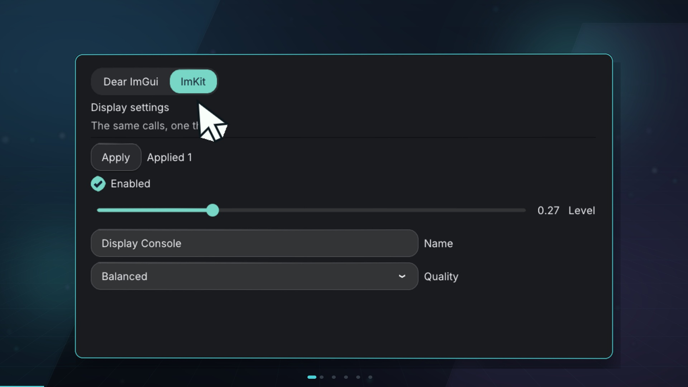](https://aokimotohide.github.io/imgui-modern-kit/en/#film)

## Overview

- **A new look, the same calls.** Add a theme, and your existing controls get rounded corners, soft shadows and short transitions. Call shapes and values stay as they are.
- **Your own look.** Build a theme from four colours, customise 22 parts across four layers (`PartOverrides`, typed `StyleScope`, `Skin`, `Interact`), or pick any of the 14 built-in presets (including `Classic` for 4.1 shapes).
- **Beyond basic widgets.** Workspace parts, a timeline, a node editor, charts, a PTZ pad, 321 icons, and an optional `show` module for media servers.
- **Your application keeps control.** The Dear ImGui context, backend, renderer, fonts, data, undo history and persistence stay in your application.

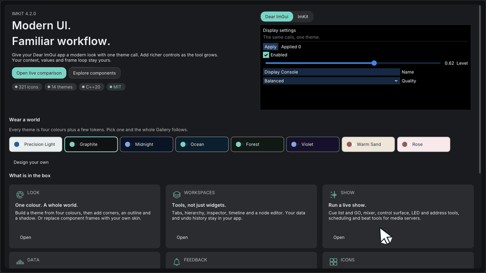

## Try the Gallery

Download the [v4.2.0 package](https://github.com/AokiMotohide/imgui-modern-kit/releases/tag/v4.2.0) for your platform, extract it and run `bin/imkit_gallery.exe` (Windows) or `imkit_gallery.app` (macOS). The package also holds a Node Editor Gallery. The Gallery uses the same public components your application links.

To build it from source on Windows:

```
cmake --preset windows-debug
cmake --build --preset windows-debug --target imkit_gallery --parallel
./build/windows-debug/catalog/Debug/imkit_gallery.exe
```

## Add ImKit to your app

Point ImKit at the Dear ImGui target your application already uses:

```cmake
set(IMKIT_IMGUI_TARGET host_imgui)
add_subdirectory(external/imgui-modern-kit)
target_link_libraries(your_app PRIVATE imkit::imkit)
```

Apply a theme before the frame starts, then draw controls in a normal window:

```cpp
#include <imkit/imkit.h>

auto theme = imkit::MakeTheme(imkit::ThemePreset::Ocean);
imkit::ApplyTheme(theme, 1.0f); // before ImGui::NewFrame()

if (imkit::Begin("Display")) {
    static bool enabled = true;
    imkit::Toggle("Enabled", &enabled);
    imkit::ActionButton("Apply", imkit::ActionVariant::Primary);
}
imkit::End();
```

## What you can build

| Area | What it gives you | CMake target | Gallery page |
| --- | --- | --- | --- |
| Look | 14 themes, 4-layer part styles (`StyleScope`, `Skin`, `Interact`), 321 icons | `imkit::imkit` | Theme Studio, Skins, Icons |
| Controls | Smooth-corner buttons, toggles, sliders, transfer curves, toasts, step bands, glow frames | `imkit::imkit` | Controls, Glow frame |
| Data | Donut, bar, gauge and sparkline charts, PTZ control | `imkit::imkit` | Data |
| Workspaces | Timeline with filmstrips, curves, inspector, hierarchy, preview monitors | `imkit::editor_suite` | Workspaces |
| Node graph | Canvas, sockets, minimap, edit requests | `imkit::node_editor` | Node Editor Gallery |
| Motion | Dear ImGui-free easing curves & CSS keyframe evaluation | `imkit::motion` | Skins |
| Show | Cue list, mixer, control surface, LED and schedule tools | `imkit::show` | Show |
| Native | Window frame, OpenGL and Metal preview, accessibility bridges | `imkit::window_frame_*`, `imkit::preview_*` | Window frame |

The [module recipes](docs/getting-started/examples-recipes.md) list the header, target and frame placement for each area.

## See it move

| | |
| --- | --- |
| 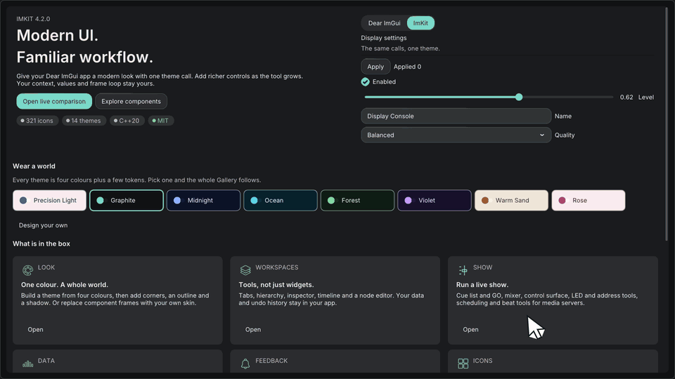<br>Pick a theme and everything follows. | 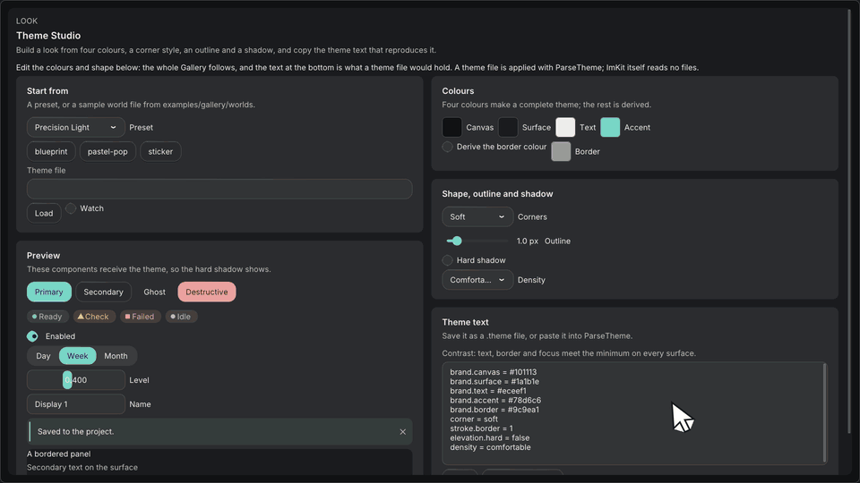<br>Load a whole look, then change corners and shadow. |
| 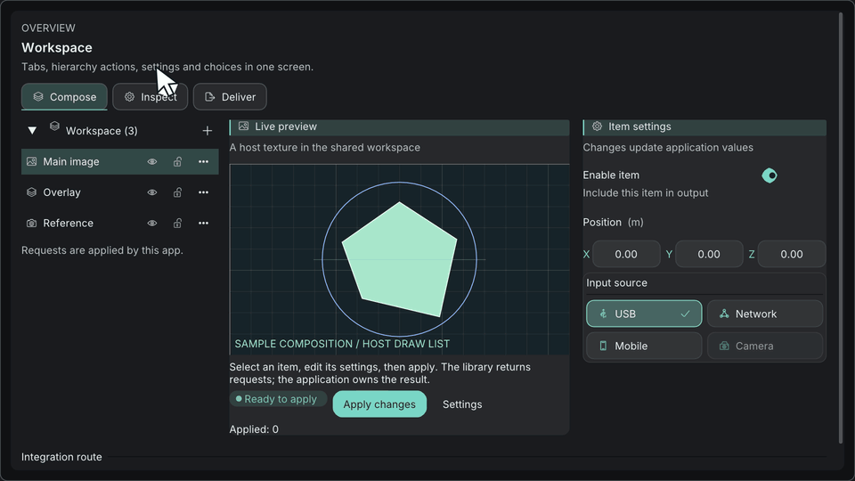<br>Tabs, hierarchy and settings in one screen. | 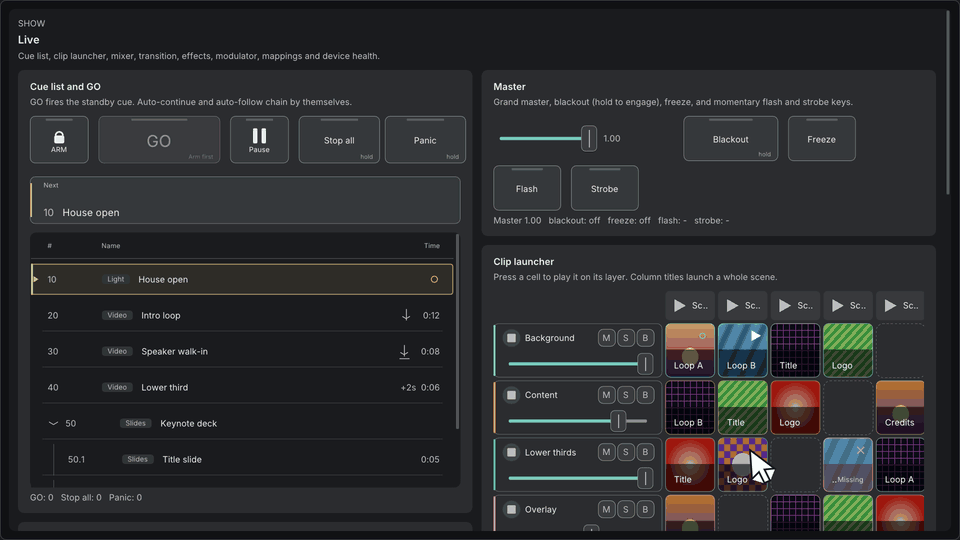<br>Run a live show with GO. |
| 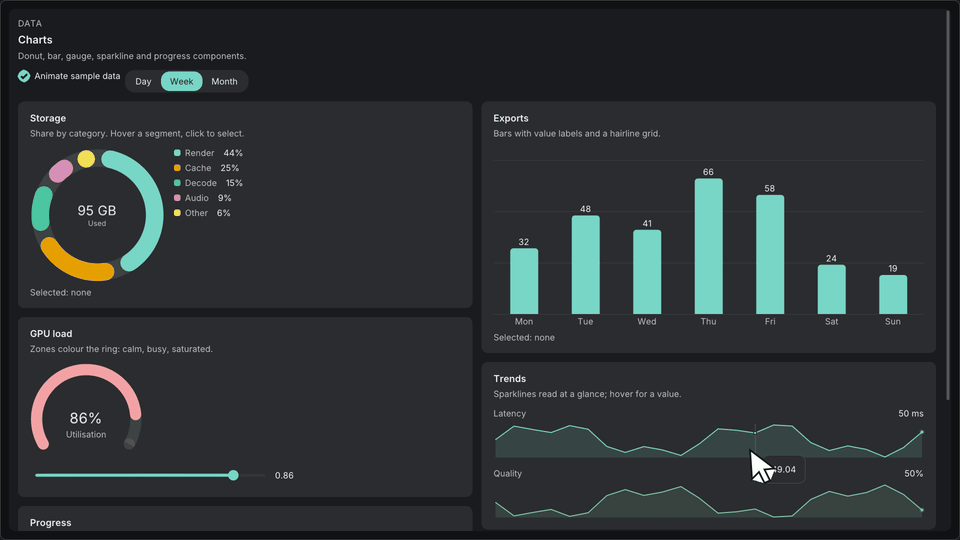<br>Donut, bar, gauge and sparkline charts. | 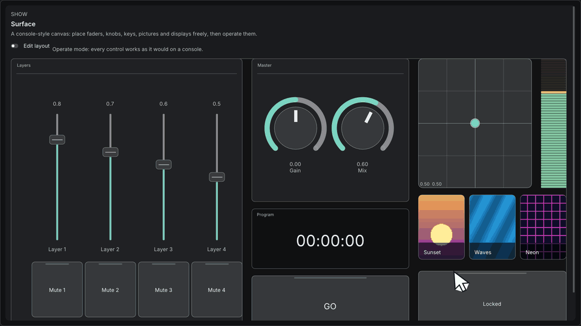<br>Lay out faders, knobs and keys like a console. |

## What is new in 4.2

- Four-layer customisation (`ThemeLook`, 22 `PartId` overrides, OKLCH colour zones and `WindowRole`), plus `Classic` as the 14th built-in theme preset.
- `DrawGlowFrame` for gradient perimeter glows and `ExternalControlIndicator` for hardware-controlled or remote-active parameter badges.
- `StepBand` for parameter automation lanes, `TransferCurveEditor` for LUT and response curves, and `ClipBody::Filmstrip` for thumbnail strips in the timeline.
- `imkit::motion`, a standalone animation library for timelines, springs and easing that compiles without Dear ImGui.

| | |
| --- | --- |
| 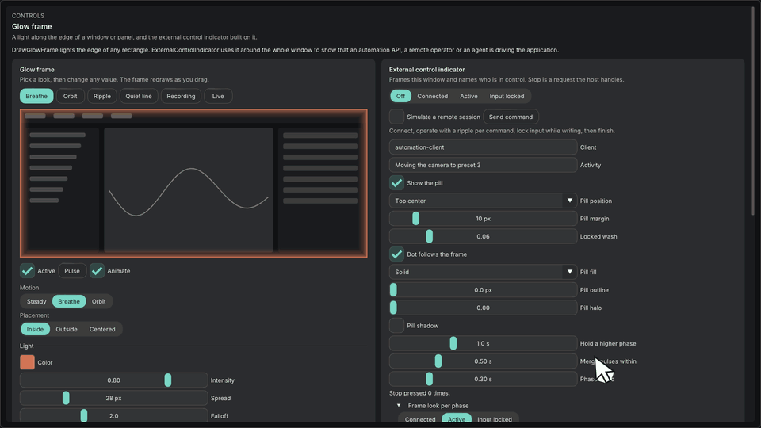<br>Gradient perimeter glows and external-control badges. | 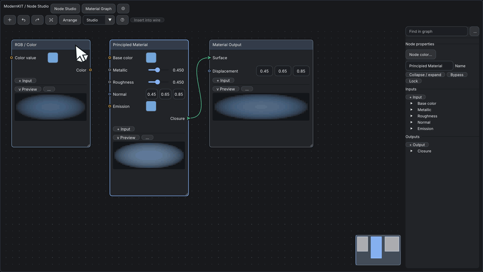<br>A node editor you can read at a glance. |
| 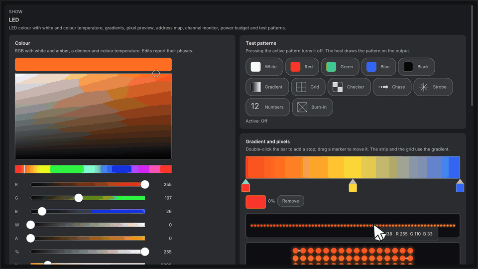<br>An LED wall as a tile map, coloured by port. | 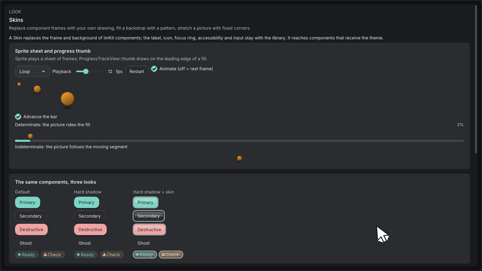<br>Sprites, and a picture that rides the progress bar. |

Rebuild your application and every linked ImKit library with the 4.2 headers. See the [migration guide](docs/reference/migration-v4.md#upgrading-from-41-to-42), the [4.2 additions](docs/reference/v4.2-api.md) and the [changelog](CHANGELOG.md). 4.0 brought the refreshed default look, brand themes, charts, PTZ, range sliders and the `show` module, and 4.1 redesigned the node editor and added `show::TileMap` and `Sprite`.

## Compatibility

The v4 ABI targets Dear ImGui 1.93.0 WIP docking commit `367b2c24f399988ddafc0bb4628da0106bcc09be`. Release packages cover Windows x64 and Arm64, and macOS arm64, x86_64 and Universal 2. The macOS packages are unsigned and not notarized. Automated checks do not establish physical input, native IME, screen-reader, mixed-DPI or third-party host acceptance; see the [validation scope](docs/reference/validation.md) and [dependencies](docs/architecture/dependencies.md).

## Documentation

[Documentation index](docs/README.md) · [Getting started](docs/getting-started/getting-started.md) · [Components](docs/getting-started/guide.md) · [Gallery guide](docs/getting-started/gallery.md) · [Node Editor](docs/components/node-editor.md) · [Architecture](docs/architecture/architecture.md) · [Changelog](CHANGELOG.md)

## Acknowledgements

**ImKit stands on [Dear ImGui](https://github.com/ocornut/imgui).** Thank you to Omar Cornut, and to every contributor and sponsor who maintains it, for a library that made tool UI in C++ fast to build and pleasant to use. ImKit is a layer on top of that work and does not replace it.

- ImKit's public headers use only Dear ImGui's public API. It does not fork or patch Dear ImGui; a small number of internal `.cpp` implementation files include `imgui_internal.h` at the pinned upstream `docking` commit (reading the active context via `GetCurrentContext()`). Your application supplies the unmodified Dear ImGui sources.
- Dear ImGui is MIT licensed, copyright Omar Cornut. [GLFW](https://www.glfw.org/) runs the Gallery window, and [Inter](https://rsms.me/inter/) and [Noto Sans JP](https://github.com/notofonts/noto-cjk) are optional fonts. Their licenses and hashes are in [THIRD_PARTY_NOTICES.md](THIRD_PARTY_NOTICES.md).
- The design references we studied are listed there as well. No code or assets were copied from them.

## License

ImKit is MIT licensed. Dear ImGui, GLFW and optional font assets keep their own licenses. The 4.2 promotional film uses an original 96-bar synthesized score created for this project (MIT) and Gemini Flash TTS narration (`provenance.json`). See [THIRD_PARTY_NOTICES.md](THIRD_PARTY_NOTICES.md) for revisions, hashes and notices.
