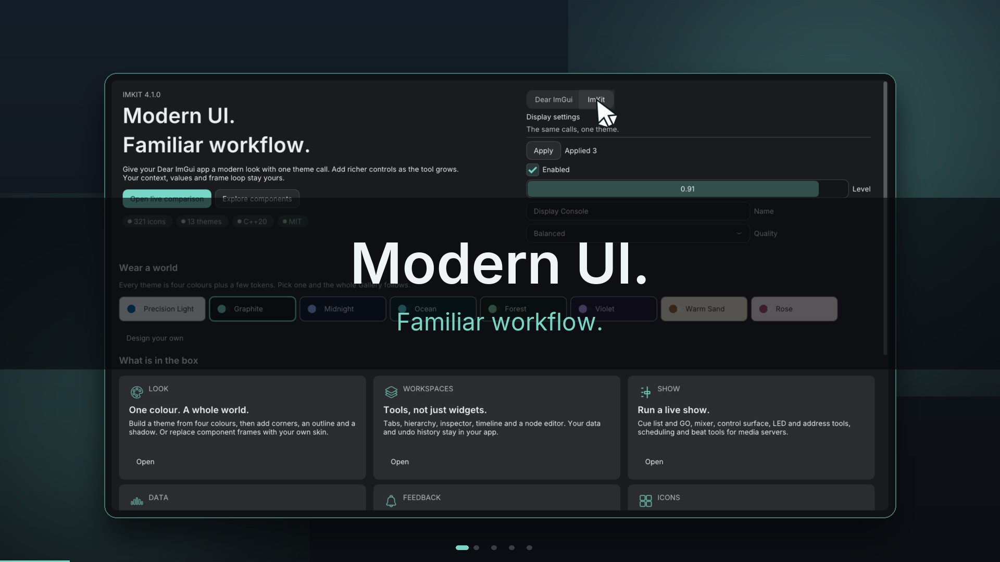
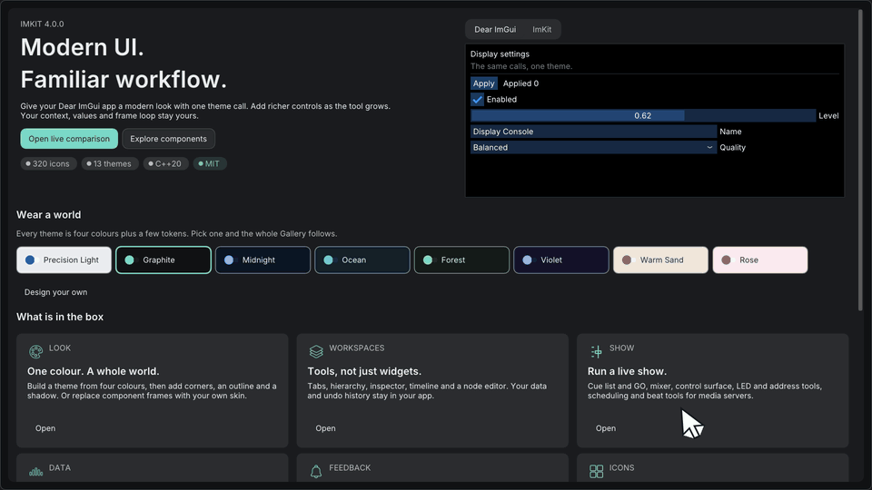
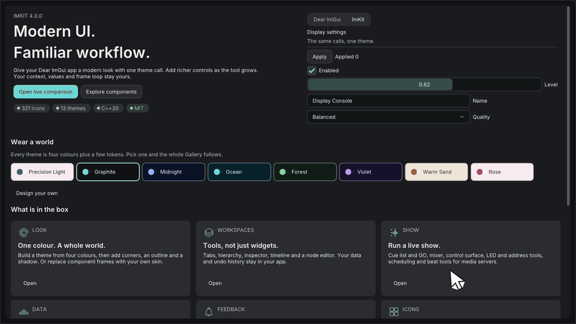
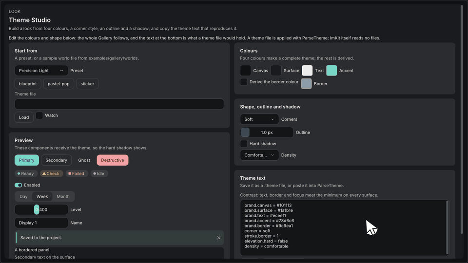
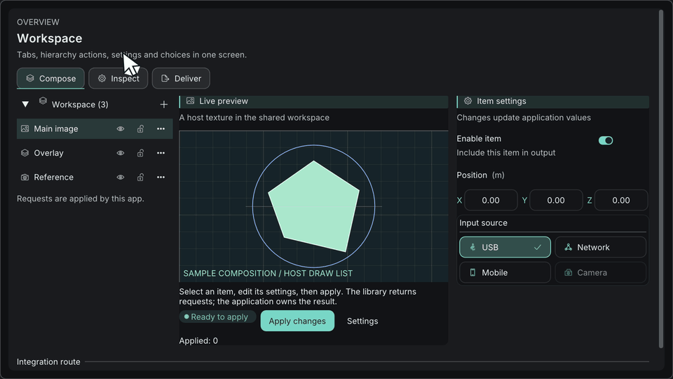
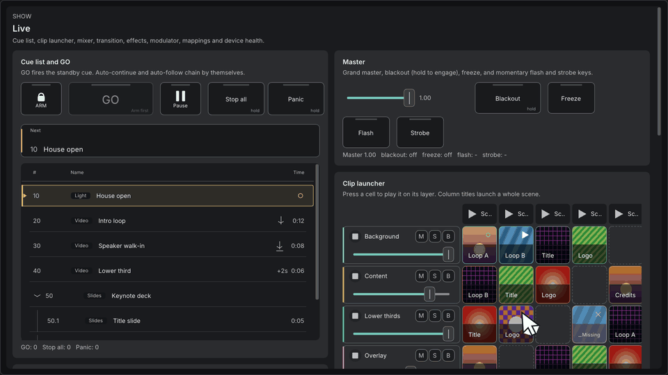
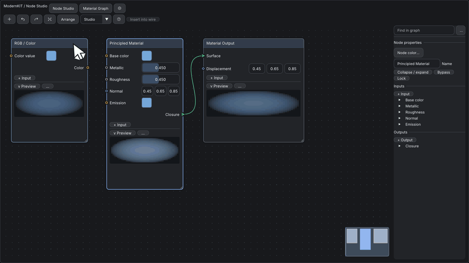
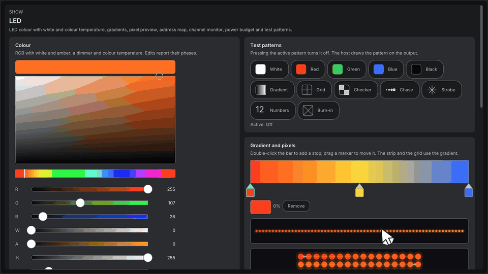
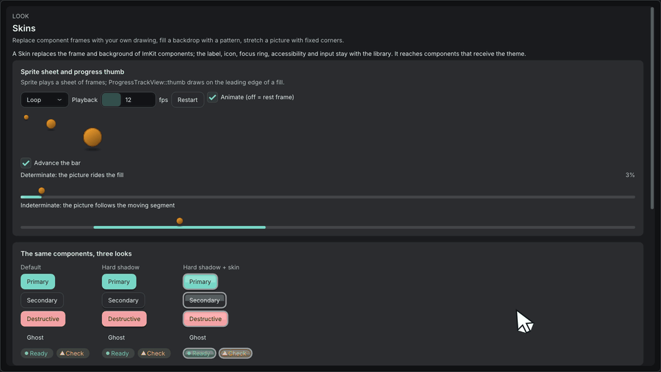

# ImKit

**Modern UI for Dear ImGui. Familiar workflow.**

ImKit is a C++20 static library that gives an existing Dear ImGui app a modern look and richer controls. Add one theme, keep your frame loop, and link only the modules you need.

[Watch the film](https://aokimotohide.github.io/imgui-modern-kit/en/#film) · [Download](https://github.com/AokiMotohide/imgui-modern-kit/releases/latest) · [Manual](https://aokimotohide.github.io/imgui-modern-kit/en/) · [API reference](https://aokimotohide.github.io/imgui-modern-kit/en/api/) · [日本語](README.ja.md)

[](https://aokimotohide.github.io/imgui-modern-kit/en/#film)

## Why ImKit

- **A new look, the same workflow.** Add a theme and your existing app picks up rounded controls, soft shadows and smooth motion. Call shapes and values stay as they are.
- **Make it yours.** Build a theme from four colours, add corners, an outline and a shadow, or replace component frames with your own skin. 13 themes are built in.
- **More than widgets.** Workspaces, a timeline, a node editor, charts, a PTZ pad, 321 icons, and an optional `show` module for media servers.
- **Your app stays yours.** The Dear ImGui context, backend, renderer, fonts, data, undo history and persistence remain in your application.



## Try the Gallery

Download the [v4.1.0 package](https://github.com/AokiMotohide/imgui-modern-kit/releases/tag/v4.1.0) for your platform, extract it and run `bin/imkit_gallery.exe` (Windows) or `imkit_gallery.app` (macOS). The package also holds a Node Editor Gallery. The Gallery uses the same public components your application links.

To build it from source on Windows:

```
cmake --preset windows-debug
cmake --build --preset windows-debug --target imkit_gallery --parallel
./build/windows-debug/catalog/Debug/imkit_gallery.exe
```

## Add ImKit to your app

Point ImKit at the Dear ImGui target your application already uses:

```cmake
set(IMKIT_IMGUI_TARGET host_imgui)
add_subdirectory(external/imgui-modern-kit)
target_link_libraries(your_app PRIVATE imkit::imkit)
```

Apply a theme before the frame starts, then draw controls in a normal window:

```cpp
#include <imkit/imkit.h>

auto theme = imkit::MakeTheme(imkit::ThemePreset::Ocean);
imkit::ApplyTheme(theme, 1.0f); // before ImGui::NewFrame()

if (imkit::Begin("Display")) {
    static bool enabled = true;
    imkit::Toggle("Enabled", &enabled);
    imkit::ActionButton("Apply", imkit::ActionVariant::Primary);
}
imkit::End();
```

## What you can build

| Area | What it gives you | CMake target | Gallery page |
| --- | --- | --- | --- |
| Look | Themes, brand colours, skins, 321 icons | `imkit::imkit` | Theme Studio, Skins, Icons |
| Controls | Buttons, toggles, sliders, inputs, tables, toasts, progress | `imkit::imkit` | Controls |
| Data | Donut, bar, gauge and sparkline charts, PTZ control | `imkit::imkit` | Data |
| Workspaces | Timeline, curves, inspector, hierarchy, preview monitors | `imkit::editor_suite` | Workspaces |
| Node graph | Canvas, sockets, minimap, edit requests | `imkit::node_editor` | Node Editor Gallery |
| Show | Cue list, mixer, control surface, LED and schedule tools | `imkit::show` | Show |
| Native | Window frame, OpenGL and Metal preview, accessibility bridges | `imkit::window_frame_*`, `imkit::preview_*` | Window frame |

The [module recipes](docs/getting-started/examples-recipes.md) list the header, target and frame placement for each area.

## See it move

| | |
| --- | --- |
| <br>Pick a theme and everything follows. | <br>Load a whole look, then change corners and shadow. |
| <br>Tabs, hierarchy and settings in one screen. | <br>Run a live show with GO. |

## What is new in 4.1

- A redesigned node editor: header fills, link colours, socket glyphs, node shapes and states, presets, draw hooks, wiring feedback, and Alt-click and Ctrl-drag on sockets.
- `show::TileMap` for tiled displays such as LED walls, coloured by port with the wiring order.
- Adjustable control sizes through `Theme::layout`.
- Sprite sheets (`Sprite`) and a picture that rides the progress fill (`ProgressTrackView::thumb`).
- A PTZ control that draws only what the camera offers (`PtzView::capabilities`).

| | |
| --- | --- |
| <br>A node editor you can read at a glance. | <br>An LED wall as a tile map, coloured by port. |
| <br>Sprites, and a picture that rides the progress bar. | |

Rebuild your application and every linked ImKit library with the 4.1 headers. Only the node editor changes its default look: see the [migration guide](docs/reference/migration-v4.md#upgrading-from-40-to-41), the [4.1 additions](docs/reference/v4.1-api.md) and the [changelog](CHANGELOG.md). 4.0 brought the refreshed default look, brand themes, charts, PTZ, range sliders and the `show` module.

## Compatibility

The v4 ABI targets Dear ImGui 1.93.0 WIP docking commit `367b2c24f399988ddafc0bb4628da0106bcc09be`. Release packages cover Windows x64 and Arm64, and macOS arm64, x86_64 and Universal 2. The macOS packages are unsigned and not notarized. Automated checks do not establish physical input, native IME, screen-reader, mixed-DPI or third-party host acceptance; see the [validation scope](docs/reference/validation.md) and [dependencies](docs/architecture/dependencies.md).

## Documentation

[Documentation index](docs/README.md) · [Getting started](docs/getting-started/getting-started.md) · [Components](docs/getting-started/guide.md) · [Gallery guide](docs/getting-started/gallery.md) · [Node Editor](docs/components/node-editor.md) · [Architecture](docs/architecture/architecture.md) · [Changelog](CHANGELOG.md)

## License

ImKit is MIT licensed. Dear ImGui, GLFW and optional font assets keep their own licenses. The film's music, "Laserpack" by Kevin MacLeod ft. DarkNES ([incompetech.com](https://incompetech.com)), is licensed under [CC BY 4.0](https://creativecommons.org/licenses/by/4.0/). See [THIRD_PARTY_NOTICES.md](THIRD_PARTY_NOTICES.md) for revisions, hashes and notices.
