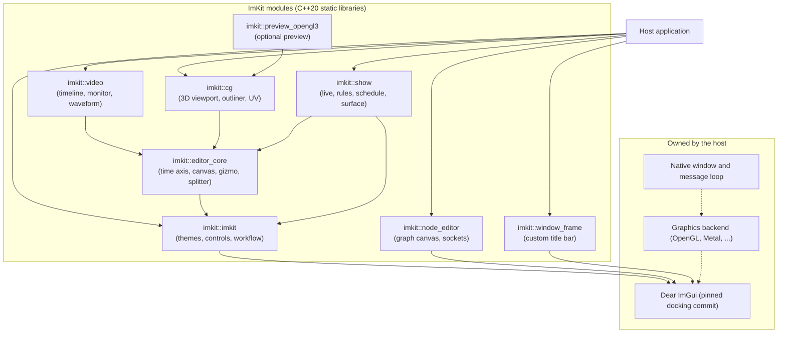

# Architecture

[日本語](アーキテクチャ.md) · [Documentation index](../README.md) · [How it works](../getting-started/how-it-works.md)

ImKit is a C++20 static UI library for tools built on Dear ImGui. This page covers the module layout, the platform boundary, who owns theme and state, how extensions are accepted, and what the editor and show modules leave to the host.

## Layout

Public headers live in `include/imkit/`, implementation in `src/`, tests in `tests/`, and the Gallery and other samples in `examples/`.

Nothing depends on `imkit::show`; it needs `imkit::editor_core` only for timecode. The base `imkit` does not depend on Editor Core. Image and preview components belong to Editor Core and reuse its canvas, selection and splitter. The [workflow components](../components/workflow-components.md) extend the patterns in the base library.

| Layer | Responsibility |
| --- | --- |
| `version.h` | Explicit baseline guard; no silent cross-version ABI claim |
| `theme.h`, `theme.cpp` | Named presets, copyable palette, metrics, fonts and motion, deterministic style derivation, nested RAII |
| `native.h` | Exact overload sets imported from the host's public Dear ImGui header |
| `widgets.h`, `widgets.cpp` | Compatible replacements for native widgets; selection, tree and tab markers drawn through the public DrawList |
| `components.h`, `components.cpp` | Small native compositions; optional theme and animation passed explicitly |
| `node_editor.h`, `node_layout.cpp` | Graph snapshots, bounded requests and deterministic layout; no graph storage or evaluation |
| Gallery host | Context, fonts, GLFW/OpenGL, image capture and representative input |

The cross-cutting design-system additions, the explicit semantic frame, and the locale and provider contracts are in [the design system](design-system.md). The legacy palette and metrics are rendering projections of the semantic tokens when you use `MakeTheme` or `ResolveTheme`. Precision Layers separates semantic design, native behavior and host state.

## What the library never does

`imkit` compiles only its own implementation. It does not:

- compile Dear ImGui or link a backend;
- create or initialize a context;
- discover fonts or persist settings;
- spawn workers.

Public wrappers keep the native Begin/End, focus, callback, disabled, clipping and ID contracts. Decoration submits no replacement item, and compound controls use native groups.

## Platform boundary

- **Renderer neutral.** Only the Gallery host compiles the official backends: GLFW with OpenGL3 on Windows, GLFW with Metal on macOS.
- **GPU resources.** The optional `preview_opengl3` and `preview_metal` targets own only their off-screen resources. The host owns contexts, devices, command buffers and submission.
- **Accessibility.** `accessibility_win32` and `accessibility_macos` copy a published semantic snapshot and return actions through the same `NativeActionSink`.
- **Window frame.** `window_frame.h` takes explicit style, metrics, features, content and state. Strings and spans are borrowed for one draw call. The core computes layout, draws in the current context and returns a typed request; it owns no native window or platform input. `window_frame_win32` and `window_frame_macos` are separate adapters that borrow an `HWND` or a Cocoa window. They install only on their own platform and add no OS dependency to `imkit::imkit`.

## Theme and state

- There is no global theme registry. `ThemePresets()` is immutable discovery data, and `MakeTheme()` returns a copyable value that the host owns. Neither stores a current selection.
- `FontSet` holds non-owning references. `AnimationState` is fixed-capacity storage with a lifecycle the host controls.
- A scope must end before its context is destroyed.
- The static SDK binds to the consumer's existing Dear ImGui target through an imported interface adapter.

## Extension policy

- Add an overload only after comparing the pinned public signature and keeping its defaults and return meaning.
- Regenerate the API inventory and the compile/link fixture with `tools/generate_api.py`.
- Supporting a new Dear ImGui version needs a deliberate adapter and style review, not a relaxed version guard.
- Derive rendering dimensions from the theme and font size, keep state bounded, and leave native editing intact.
- Keep host-specific data and services out of the library.

## Editor module ownership

| Module | Draws from | Returns | The host keeps |
| --- | --- | --- | --- |
| Node Editor (optional target) | A graph snapshot borrowed for one frame | Bounded edit requests | Socket policy, compatibility, revision acceptance, model changes, previews, undo, persistence. The Material Graph companion is a specimen, not a renderer. |
| Editor Core, Video, CG | Non-owning provider views | Fixed-buffer events | Scene and media data, selection, undo, workers, context. The optional OpenGL3 preview owns only its GPU resources; its context and GL function table come from the host. |

CG transforms keep rotation, scale and upper-triangular shear for oriented non-uniform scaling. Scale events carry the affine terms, and the host applies them together with the scale. Both preview paths use the same linear map and inverse-transpose normals. See the [Editor Suite contracts](../components/editor-suite.md).

## Show module ownership

The optional `imkit::show` target (`imkit/show.h`) sits beside Editor Core. Components draw and return requests; the host applies them.

| Component | Returns |
| --- | --- |
| Continuous controls | `ValueEdit` |
| Rule builder, sequencer | Edits in fixed-capacity buffers |
| Calendar | Request structs for moves |
| Control surface | Snapped rectangles for moves and resizes |

The host owns every value, texture and picture file (picture buttons ask for a file and never load one), the surface layout model, the clock (UTC seconds plus a time-zone callback), MIDI, OSC and DMX devices, media playback, script analysis and persistence. Pure functions (`EvaluateRule`, `NextOccurrences`, `ParseCron`, `SolarEvents`, `FindConflicts`, `DetectDelimiter` and others) carry the logic, so it can be tested without a context. Colours derive from semantic theme tokens; there is no Show-specific theme field. See the [Show module](../components/show.md).
