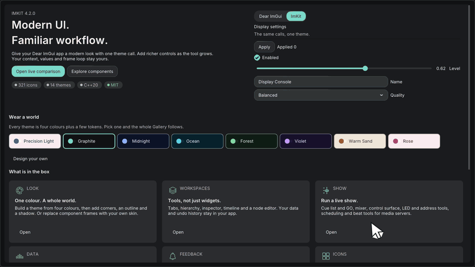

# Themes and customization

[日本語](テーマ.md) · [Documentation index](../README.md) · [Design system](design-system.md) · [Make your own look](make-your-own-look.md)

ImKit has thirteen named presets and a set of functions to adjust or build your own. A `Theme` is a plain value that your application owns, and `ApplyTheme` writes it into the current Dear ImGui context.



## Built-in presets

`ThemePresets()` returns the presets in a stable display order. Each `ThemePresetInfo` holds the enum value, a stable lowercase ID for saving (for example `"precision-dark"`), an English display name and the Light or Dark scheme.

| Scheme | Preset | Character |
| --- | --- | --- |
| Dark | `PrecisionDark` | The standard dark theme: neutral grey with a blue accent |
| | `Graphite` | Near-black grey with a mint accent |
| | `Midnight` | Deep navy with a lavender-blue accent |
| | `Ocean` | Dark teal with a cyan accent |
| | `Forest` | Deep green with a green accent |
| | `Violet` | Dark purple with a purple accent |
| | `Slate` | Blue-grey canvas and surfaces |
| | `HighContrastDark` | Raised contrast for legibility |
| Light | `PrecisionLight` | The standard light theme: white and pale grey |
| | `WarmSand` | Sand beige with a brown accent |
| | `Rose` | Pale pink with a rose accent |
| | `Solar` | Warm cream with an olive-gold accent |
| | `HighContrastLight` | Raised contrast for legibility |

`PrecisionLight`, `PrecisionDark`, `Slate` and the two high-contrast presets have hand-tuned palettes. The other eight are built by `MakeBrandTheme` from four colours: canvas, surface, text and accent. They also show what an application can do with the same function (see [Make your own look](make-your-own-look.md)).

## Choose and restore a theme

Save the stable ID, not the enum value, and resolve it again with `ThemePresetFromId`. An unknown or differently cased ID returns `std::nullopt`, so you choose the fallback.

```cpp
#include <imkit/theme.h>

// From a preset
imkit::Theme theme = imkit::MakeTheme(imkit::ThemePreset::Forest);

// From a saved ID, with a fallback
const auto preset = imkit::ThemePresetFromId(savedPresetId)
    .value_or(imkit::ThemePreset::PrecisionDark);
imkit::Theme current = imkit::MakeTheme(preset);
```

`MakePrecisionTheme(Light/Dark)` is kept for source compatibility and gives the same Precision values.

## Customize

```cpp
// Change the accent. Buttons, focus rings and selection follow.
imkit::SetAccent(theme, ImVec4(1.0f, 0.5f, 0.0f, 1.0f));
```

| Field | Role |
| --- | --- |
| `semantic`, `typography`, `radius`, `stroke`, `elevation`, `opacity` | The source of truth. Edit these, then call `ResolveTheme(theme)`. |
| `colors`, `metrics` | Projections that `ResolveTheme` and `SetDensity` rebuild. Direct edits are overwritten. |
| `layout` | Optional size overrides: control height, spacing, padding, and the ratios for Checkbox, Toggle, badge and dialog. Applied after the density. A value you leave unset keeps the density, so a theme that sets nothing draws as before. |
| `motion`, `editor` | Edit explicitly when you need to. |

`SetAccent` updates the accent, focus colour, contrasting text on the accent and the selection. Arbitrary edits are not contrast-corrected automatically.

The shipped presets keep normal text at 4.5:1 or better against canvas, surface, input and raised surfaces, and accent and destructive foreground pairs at 4.5:1 or better. `ResolveTheme` raises secondary and disabled text to 4.5:1 on the surface and the panel zone, because they are read as captions. Check your own theme with `ValidateContrast`.

### Corners and type steps

| Token | Default | Rule |
| --- | --- | --- |
| `radius.controlShare` | `.25` | `ResolveTheme` derives the radii from the control height: control = height × share, subtle = half of it, overlay = height × share × 1.6. Set it to 0 to keep pixel radii. `CornerStyle` has `Sharp` (pixel radii), `Soft` (.25) and `Round` (.36); there is no capsule style |
| `typography` | caption 12, body 14, heading 15, title 22 | Headings sit one step above the body so a panel title never shouts |
| `layout.checkHeightScale` | 1.15 | Check boxes and radio buttons stay close to the text height |

Splitters and resize grips use the `divider` zone colour, which stands apart from every zone, and turn to the accent under the pointer. A theme file sets `radius.control-share`; radii given in pixels without it switch the proportional corner off.

## Surface zones

`ResolveTheme` also derives `Theme::zones`, one colour for each large region of a window, so neighbouring regions read as separate places in every preset and brand theme.

| Zone | Use | Derivation |
| --- | --- | --- |
| `Chrome` | Menu bar, step band | `semantic.crown` when given. Otherwise dark: the raised surface leaning to the accent; light: the canvas washed with the accent |
| `Panel` | Lists, step lists | The surface |
| `Inspector` | Settings panels | The panel's lightness, turned up to 26° toward the accent's hue and calmer |
| `Header` | Heading rows, floating tool windows | A step from the panel |
| `Workspace` | Gaps between panels, around the main view | The panel, a step darker |
| `Monitor` | Inside a picture | An almost neutral, deep tone of the theme |
| `ChromeCanvas` | A strip of previews inside the chrome | A deep tone of the chrome |

Zones are stepped in OKLCH lightness, so the steps look even in every theme, and neighbouring zones stay at least 1.14:1 apart. `Panel` and `Inspector` share a lightness and differ only in hue. `onMonitor` is text that reads on the monitor zone and `divider` is the line between zones; it keeps at least 1.3:1 (dark) or 1.6:1 (light) against the zones it separates. Call `PushSurfaceZone(theme, zone)` before a window's `Begin` and `PopSurfaceZone()` right after it; `SurfaceZoneColor` returns a zone colour for your own drawing. To override a zone, assign it after `ResolveTheme`.

### Window roles

`ResolveTheme` also derives `zones.roles`, one set of colours per `WindowRole`, from the zones above, so the same rule serves every preset and brand theme.

| Role | Use | Body |
| --- | --- | --- |
| `Browse` | Lists, outliners | `panel` |
| `Edit` | Inspectors, property panels | `inspector` |
| `View` | Around the main view | `workspace` |
| `Monitor` | A strip of previews | `chromeCanvas` |

Each role has `body`, `emphasis` (section headers and the selected row, at least 1.25:1 from the body, in its hue) and `label` (the tab line of an unfocused window, in the body's hue; the chrome's hue for `Monitor`). Call `PushWindowRole(theme, role)` before a window's `Begin` and `PopWindowRole()` after its `End`. Docked tabs keep the colours pushed at `Begin`; the focused tab line takes the accent. The line shows only when `ImGuiStyle::TabBarOverlineSize` is above zero. Input fields keep the theme's own colour.

## What `ApplyTheme` does

`ApplyTheme` replaces the whole `ImGuiStyle` of the current context, except `Alpha` and `FontScaleDpi`. Make your adjustments in the `Theme`, not in `ImGuiStyle`, because the next `ApplyTheme` overwrites style edits you made directly.

| Topic | Rule |
| --- | --- |
| Scale | `ApplyTheme(theme, scale)` rebuilds the style from unscaled values, so repeated calls never compound sizes. The range is 50% to 250% and the default is 125% (`ThemeScaleMinimum`, `ThemeScaleDefault`, `ThemeScaleMaximum`). Monitor DPI is your application's job. |
| Scope | `ThemeScope` applies a theme for a block and restores the previous style and font when it ends. Scopes nest on the same live context. |
| Fonts | `FontSet` holds borrowed pointers. Load glyphs into your atlas before the frame. ImKit does not find OS fonts or provide IME callbacks. |
| Ownership | `Theme` is a copyable value. ImKit has no current-theme registry and writes no files. Store a preset ID, or a complete customized value, in your own settings, and apply it again when needed. |
