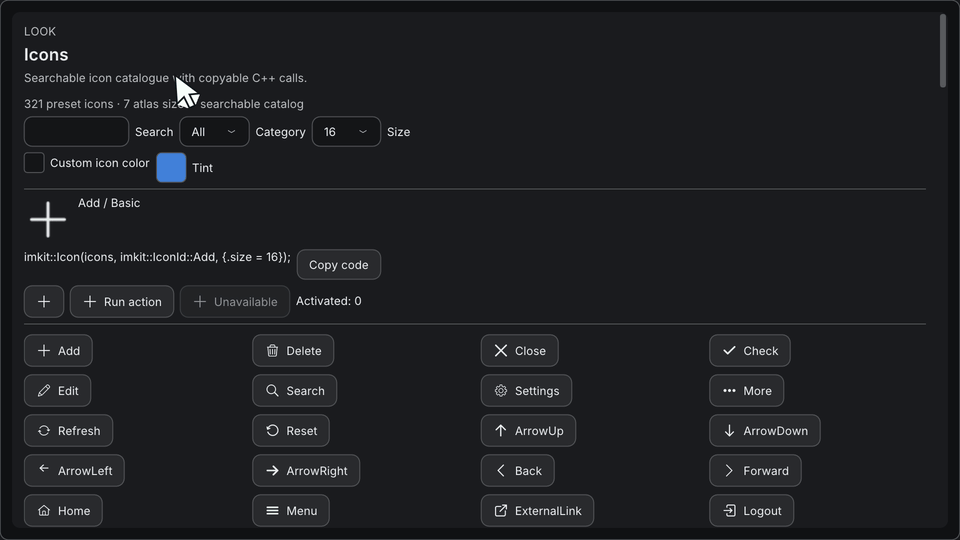
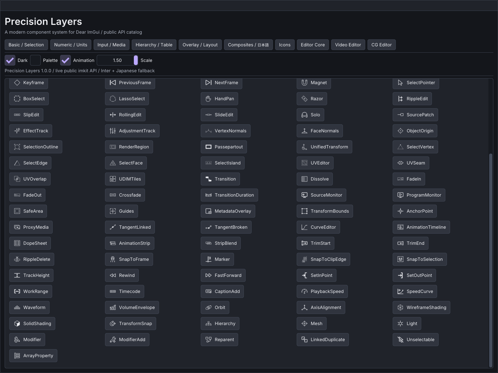

# アイコン

[English](icons.md) · [目次](../目次.md) · [テーマ](テーマ.md) · [実例とレシピ](../getting-started/実例とレシピ.md)

ImKitには、21のカテゴリに分けた321個の線画アイコンが入っています。ライブラリは、アプリがアップロードしたテクスチャアトラスから描くので、画像デコーダー、ファイル検索、独自のレンダラーは要りません。



## 概要

| 項目 | 内容 |
| --- | --- |
| アイコン | 21カテゴリに321個。一覧は`assets/icons/catalog.json` |
| ラスターのサイズ | 12、16、20、24、32、48、64px。サイズごとに1枚のアトラス |
| 色 | アルファ付きの白いグリフ。明るいUIでも暗いUIでも、好きな色を付けられる |
| ヘッダー | `<imkit/imkit.h>`または`<imkit/icons.h>` |
| GPUテクスチャの持ち主 | アプリ |

## アイコンを使う

サイズごとにアトラスを1枚アップロードし、それぞれを`IconAtlas`に結び付けてから、通常のフレームの中で描きます。

```cpp
imkit::IconAtlas icons;                       // レンダラーのリソースと一緒に持つ
for (int size : imkit::IconPixelSizes) {
    const auto pixels = imkit::GetIconAtlasPixels(size);
    // pixels.width x pixels.height のRGBA8（ストレートアルファ）をアップロードする。
    // リニアフィルタ、clamp-to-edge、ミップマップなし。GPUリソースは生かしておく。
    ImTextureRef texture = UploadRgbaTexture(pixels.width, pixels.height, pixels.rgba);
    icons.SetTexture(size, texture);
}

// いつものImGuiのフレームとウィンドウの中で:
imkit::Icon(icons, imkit::IconId::Search);                         // 論理20ピクセル、現在の文字色
imkit::Icon(icons, imkit::IconId::Warning,
            {.size = 24, .color = ImVec4(0.9f, 0.6f, 0.1f, 1)});
if (imkit::IconButton("save", icons, imkit::IconId::Save, "Save document")) {
    SaveDocument();
}
if (imkit::IconLabelButton("open", icons, imkit::IconId::FolderOpen, "Open")) {
    OpenDocument();
}
ImGui::BeginDisabled();
imkit::IconButton("delete", icons, imkit::IconId::Delete, "Delete selection");
ImGui::EndDisabled();

// これらのテクスチャを使う最後の描画呼び出しが終わったあとで:
icons.Clear();
// そのあと、レンダラーの通常の規則でGPUテクスチャを破棄する。
```

`UploadRgbaTexture`、`SaveDocument`、`OpenDocument`は、アプリの関数で、ImKitのAPIではありません。OpenGLでの具体的なアップロードは、`examples/gallery/main.cpp`にあります。矢印ボタン用に、`IconButton(id, ImGuiDir, accessibleLabel)`のオーバーロードもあります。

## 動作

| 項目 | 規則 |
| --- | --- |
| カタログ | `GetIconCatalog()`は、安定したID、英語名、カテゴリを返します。`GetIconInfo`は、不正なIDにはnullを返します。 |
| アトラスのデータ | `GetIconAtlasPixels`が受け付けるのは、12、16、20、24、32、48、64だけです。CPU側のデータは変更できず、プロセスの終了まで有効です。ほかのサイズは、空のビューを返します。 |
| UV | `GetIconRegion`が、正規化した矩形を返します。各セルの周囲に透明な2ピクセルがあり、リニアフィルタで隣のグリフがにじむのを防ぎます。 |
| サイズの選択 | 7つのサイズをすべて結び付けます。描画では、`options.size * max(DisplayFramebufferScale)`を満たす最小のレベルを、最大64まで選びます。物理サイズが64を超えると、64pxのビットマップを拡大するため、やわらかく見えます。`options.size`の既定は論理20ピクセルです。UIのスケールに合わせて変えてください。 |
| 色 | 色を指定しなければ、`ImGuiCol_Text`を使います。色合いは、グリフだけに影響します。ボタンの文字は、テーマの文字色のままです。無効の状態を含め、スタイルのアルファが掛かります。 |
| ボタン | Dear ImGui標準の当たり判定、フォーカス、ホバー、押下、無効の動作を使います。`id`には、変わらないnullでない値を渡します。ラベルは、ホバーとフォーカスのツールチップで、`##`より後ろの文字は描かれません。OSのアクセシビリティの橋渡しではありません。 |
| データがないとき | 不正なIDや、結び付けていないサイズでは、グリフを描きません。`Icon`はそれでも場所を確保し、ボタンは何も起きない代わりに無効になります。 |
| 寿命 | レンダラーや独立したContextごとに、`IconAtlas`を1つ持ちます。グローバルな登録はありません。`Clear`は結び付けを外すだけで、GPUリソースは削除しません。 |

`cg::ObjectView::icon`を使うと、3Dのアウトライナーが、`ObjectKind`を拡張せずに、カタログの任意のグリフを選べます。

## 素材と再生成

| 場所 | 内容 |
| --- | --- |
| `assets/icons/{12,16,20,24,32,48,64}` | サイズごとに321枚の透過PNG。合計2,247枚 |
| `assets/icons/atlases` | 7枚のアトラスPNG |
| `assets/icons/originals`、`assets/icons/prompts` | 238枚の元画像と、それを生成したプロンプト。ソースツリーに残し、SDKにはコピーしません。 |
| `assets/icons/provenance.json` | 元ファイルのハッシュ |
| `share/imkit/icons` | CMakeのインストールで、PNGとアトラスを置く場所 |

ラスターの絵は、画像生成ツールで、1枚ずつ作りました。形状は近似で、数学的に同一の線の体系でも、アイコンフォントでもありません。それ以外のアイコンはコードで描き、元のビットマップは要りません。絵は、このリポジトリの一部で、MITライセンスです。

利用者に、生成ツール、キー、Pythonは要りません。元画像を差し替えたあと、派生ファイルを作り直すには、Pillowをインストールして`python tools/build_icons.py`を実行します。元画像を保ち、範囲をそろえ、アルファの形を変えずにRGBを白にして、PNGの各サイズと`src/icons_data.inc`を書き出します。`python tools/build_icons.py --check`は、すべての元画像、ハッシュ、画像、アトラスの領域を検証します。

最初の120個の名前は、`stable-ids.json`で固定されています。新しいIDは、末尾に追加するだけなので、既存のIDの順序は変わりません。

## Galleryで確かめる

Icons画面では、カテゴリと名前で検索し、7つのサイズを切り替え、色合いと操作の状態を試せます。下の画像は、150%スケールのエディタ用アイコンです。


