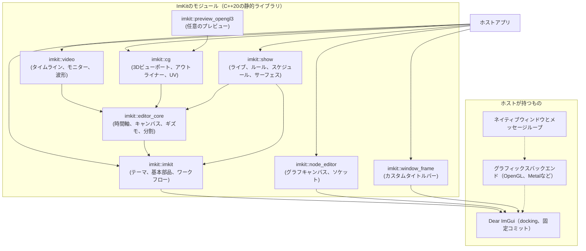

# アーキテクチャと設計方針

[English](architecture.md) · [目次](../目次.md) · [仕組みと設計思想](../getting-started/仕組みと設計思想.md)

ImKitは、Dear ImGuiで作る制作ツール向けの、C++20の静的UIライブラリです。この文書は、モジュールの構成、プラットフォームの境界、テーマと状態の所有、拡張の受け入れ方、エディタとShowモジュールがホストに残すものをまとめます。

## 構成

公開ヘッダーは `include/imkit/`、実装は `src/`、テストは `tests/`、Galleryなどのサンプルは `examples/` にあります。

`imkit::show` に依存するものはありません。`imkit::editor_core` が必要なのは、タイムコードだけです。基本の `imkit` はEditor Coreに依存しません。画像とプレビューの部品はEditor Coreに属し、そのキャンバス、選択、スプリッターを再利用します。[ワークフロー部品](../components/ワークフローコンポーネント.md)は、基本ライブラリのパターンを拡張したものです。

| 層 | 責務 |
| --- | --- |
| `version.h` | 基準版の明示的なガード。版をまたぐABIを、黙って保証しない |
| `theme.h`、`theme.cpp` | 名前付きプリセット、複製できるパレット・metrics・フォント・動き、決定的なスタイル導出、入れ子のRAII |
| `native.h` | ホストの公開Dear ImGuiヘッダーから取り込む、正確なオーバーロード群 |
| `widgets.h`、`widgets.cpp` | ネイティブ部品と互換の置き換え。選択・ツリー・タブの目印は、公開のDrawListで描く |
| `components.h`、`components.cpp` | 小さなネイティブの組み合わせ。テーマとアニメーションは、必要なときだけ明示的に渡す |
| `node_editor.h`、`node_layout.cpp` | グラフのスナップショット、容量付きの要求、決定的なレイアウト。グラフの保持と評価はしない |
| Galleryホスト | Context、フォント、GLFW/OpenGL、画像の撮影、代表的な入力 |

デザインシステムに共通する追加、明示的なセマンティックの枠、ロケールとプロバイダーの契約は、[デザインシステム](デザインシステム.md)にあります。`MakeTheme` や `ResolveTheme` を使うとき、従来のパレットとmetricsは、セマンティックトークンから導く描画用の射影です。Precision Layersは、意味のデザイン、ネイティブの挙動、ホストの状態を分けます。

## ライブラリがしないこと

`imkit` がコンパイルするのは、自分の実装だけです。次のことはしません。

- Dear ImGuiをコンパイルする、バックエンドをリンクする
- Contextを作る、初期化する
- フォントを探す、設定を保存する
- ワーカーを起動する

公開のラッパーは、ネイティブのBegin/End、フォーカス、コールバック、無効化、クリッピング、IDの契約を保ちます。装飾は代わりの項目を送らず、複合部品はネイティブのグループで作ります。

## プラットフォームの境界

- **描画に依存しない。** 公式バックエンドをコンパイルするのは、Galleryホストだけです。Windowsは GLFW と OpenGL3、macOSは GLFW と Metal です。
- **GPUリソース。** 任意の `preview_opengl3` と `preview_metal` が持つのは、オフスクリーンのリソースだけです。Context、デバイス、コマンドバッファ、投入はホストが持ちます。
- **アクセシビリティ。** `accessibility_win32` と `accessibility_macos` は、公開されたセマンティックスナップショットを複製し、操作を同じ `NativeActionSink` で返します。
- **ウィンドウ枠。** `window_frame.h` は、スタイル、metrics、機能、内容、状態を明示的な値で受け取ります。文字列とspanは、1回の描画の間だけ借ります。コアはレイアウトを計算し、現在のContextに描いて、型付きの要求を返します。ネイティブウィンドウとプラットフォームの入力は持ちません。`window_frame_win32` と `window_frame_macos` は別のアダプターで、`HWND` またはCocoaのウィンドウを借ります。対応するプラットフォームにだけ入り、`imkit::imkit` にOS依存を加えません。

## テーマと状態

- グローバルなテーマ登録はありません。`ThemePresets()` は不変の探索用データで、`MakeTheme()` は、ホストが持つ複製可能な値を返します。どちらも、現在の選択を保持しません。
- `FontSet` は所有しない参照を持ちます。`AnimationState` は固定容量の領域で、寿命はホストが決めます。
- スコープは、Contextを破棄する前に終える必要があります。
- 静的SDKは、利用側にすでにあるDear ImGuiのターゲットに、インポートしたインターフェースのアダプターで結び付きます。

## 拡張の方針

- オーバーロードを足すのは、固定した公開シグネチャと比べ、既定値と戻り値の意味を保てると確かめてからです。
- API一覧とコンパイル/リンクの検査用ファイルは、`tools/generate_api.py` で作り直します。
- 新しいDear ImGuiの版に対応するには、バージョンガードを緩めるのでなく、アダプターとスタイルを意図して見直します。
- 描画の寸法はテーマとフォントサイズから導き、状態の容量は有限にし、ネイティブの編集は壊しません。
- ホスト固有のデータとサービスは、ライブラリに入れません。

## エディタモジュールの所有

| モジュール | 描画の元 | 返すもの | ホストが持つもの |
| --- | --- | --- | --- |
| Node Editor（任意のターゲット） | 1フレームだけ借りるグラフのスナップショット | 容量付きの編集要求 | ソケットの方針、互換性の判断、リビジョンの受理、モデルの変更、プレビュー、Undo、保存。Material Graphの付属アプリは見本で、レンダラーではない |
| Editor Core、Video、CG | 所有しないプロバイダーのビュー | 固定バッファのイベント | シーンとメディアのデータ、選択、Undo、ワーカー、Context。任意のOpenGL3プレビューが持つのは自分のGPUリソースだけで、ContextとGL関数表はホストから来る |

CGのトランスフォームは、向きのある非一様スケールのために、回転、スケール、上三角のせん断を保ちます。スケールのイベントはアフィン項を運び、ホストがスケールと一緒に適用します。2つのプレビュー経路は、同じ線形変換と、逆転置の法線を使います。[Editor Suiteの契約](../components/エディタスイート.md)を参照してください。

## Showモジュールの所有

任意のターゲット `imkit::show`（`imkit/show.h`）は、Editor Coreと並びます。部品は描画して要求を返し、ホストが適用します。

| 部品 | 返すもの |
| --- | --- |
| 連続値の部品 | `ValueEdit` |
| ルールビルダー、シーケンサー | 固定容量のバッファの編集 |
| カレンダー | 移動の要求構造体 |
| コントロールサーフェス | 移動とサイズ変更を、スナップ済みの矩形で |

ホストが持つのは、すべての値、テクスチャ、画像ファイル（画像ボタンはファイルを要求するだけで、読み込みません）、サーフェスの配置モデル、時計（UTC秒とタイムゾーンのコールバック）、MIDI・OSC・DMXの機器、メディア再生、スクリプトの解析、保存です。`EvaluateRule`、`NextOccurrences`、`ParseCron`、`SolarEvents`、`FindConflicts`、`DetectDelimiter` などの純関数が論理を担うので、Contextなしで試験できます。色はテーマのセマンティックトークンから導き、Show専用のテーマ項目はありません。[Showモジュール](../components/ショーモジュール.md)を参照してください。
