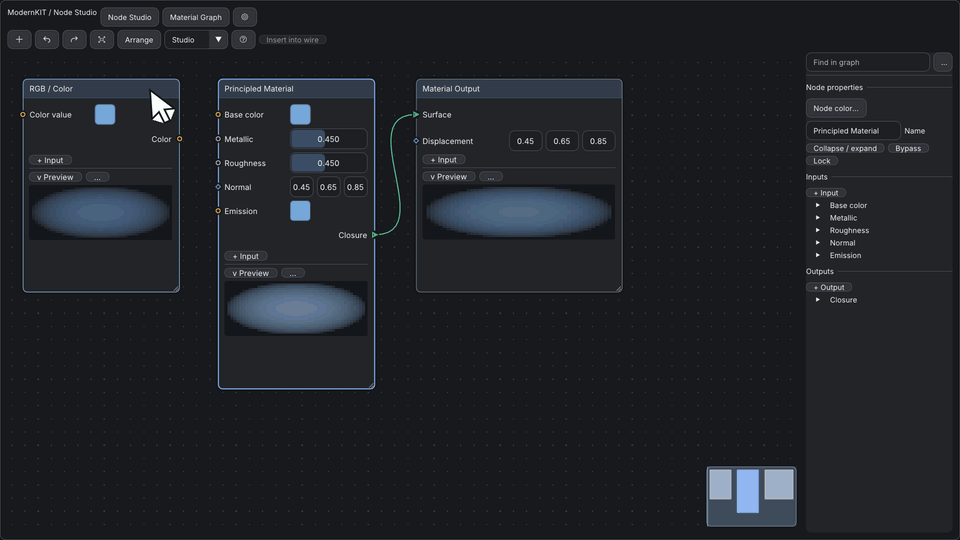

# Node editor

[日本語](ノードエディタ.md) · [Documentation index](../README.md) · [Build a node editor](../tutorials/build-node-editor.md)

The independent `imkit::node_editor` target provides native Dear ImGui node editing, context-free layout utilities and host-driven previews. `imkit::editor_suite` includes it, and it can also be linked on its own. Include `<imkit/node_editor.h>`. The baseline is the pinned Dear ImGui 1.93.0 WIP docking commit and C++20.



This is an original implementation. `imgui-node-editor` is an API and interaction reference, not a source, build or runtime dependency, and no third-party assets were added. The standalone demo optionally loads the installed Windows Segoe UI font; the library neither redistributes nor loads it.

Status: development API. [Checks and limits](#checks-and-limits) lists what is verified.

## Ownership

| The library | The host |
|---|---|
| Draws nodes, sockets, links and previews, and reports complete edit requests | Graph data, IDs and revisions, undo, clipboard bytes, file persistence, node evaluation, workers, textures, contexts, backend initialization |

`CaptureView` and `RestoreView` return and accept value state. Serializing it is the host's job.

## First frame

```cpp
namespace ne = imkit::node_editor;
// Host-owned and persistent. Reserve is optional and is not a node limit.
ne::EditorState editor;
editor.Reserve(1024);
std::vector<ne::EditRequest> storage(4096); // keep large buffers off the stack

// Each frame: build the graph view from your model. Views and labels stay alive through the draw.
ne::RequestBuffer requests{storage};
auto style = ne::MakeNodeStyle(theme);
auto frame = ne::BeginEditor("graph", graph, editor, requests, style);
ne::DrawLinks(frame); // schedules the graph links
for (const auto& node : graph.nodes) {
    if (ne::BeginNode(frame, node.id)) {
        // Ordinary native ImGui controls, using the available content width.
        // Draw the body and Preview only when !node.collapsed and
        // editor.zoom >= style.detailZoom (DrawNodes does this for you).
        DrawMyNodeProperties(node.id);
        ne::EndNode(frame);
    }
}
ne::NodePalette(frame, availableNodeTypes);
ne::EndEditor(frame); // always paired, even for a clipped or invalid graph
ApplyMyCompleteTransactions(requests.Requests());
```

- `BeginNode`/`EndNode` and `BeginPin`/`EndPin` take the explicit frame. There is no global current editor.
- Node and socket IDs are strongly typed 64-bit values. Zero is reserved, and IDs must be unique within the current graph.
- Positions and sizes are in graph units. A socket offset is measured along its selected node edge.
- Graph data is borrowed and immutable for the entire draw, including detached previews and inspector panels. Do not reallocate graph spans from a drawing callback.
- `EditorState` owns only UI state and scratch data, never your graph. Each simultaneous view or context needs its own state.
- Do not copy an active frame or nest node scopes.

## Layout without an ImGui context

```cpp
std::vector<ne::PositionChange> changes(graph.nodes.size());
ne::AlignOptions options;
options.alignment = ne::Alignment::Left;
options.reference = ne::AlignReference::Node;
options.anchor = lastSelected;
auto result = ne::AlignNodes(graph, selectedIds, changes, options);
if (result) {
    ne::QueueLayout(graph, std::span(changes).first(result.count), requests,
                    editor.nextOperation++);
}
```

| API | Behavior |
|---|---|
| `AlignNodes` | Left, center, right, top, middle, bottom; selection bounds, anchor node or explicit rectangle |
| `DistributeNodes` | Horizontal or vertical centers, or edge gaps; locked nodes partition stationary intervals |
| `ArrangeNodes` | Connection-directed layers, horizontal or vertical, deterministic cycle remainder |
| `SnapNodesToGrid` | Explicit position quantization; never rearranges the graph on its own |
| `FitGroupToContents` | Returns container bounds including padding; the host applies position and size together |
| `FrameNodes` | Changes only the view; an empty selection frames the graph |
| `TraceNodes` | Cycle-safe upstream or downstream selection candidates |

- Layout returns changed positions only.
- Capacity, invalid geometry, duplicate IDs, missing selections and invalid containment fail without partially writing the output.
- Moving a container preserves the offsets of its unlocked descendants. A descendant selected together with its ancestor is not moved twice. Locked subtrees stay in place.
- Arrange partitions visual parents and avoids stationary sibling rectangles. It is a practical layered layout, not a general constraint solver or an optimal router.
- Center and gap distribution keep the end nodes. Gaps can be negative when the bounding interval is smaller than the combined node sizes.

## Edit requests

`RequestBuffer` emits complete operation batches. For each batch:

1. Consume `operationSize` records together.
2. Check `graph` and `revision`.
3. Apply or reject the complete operation. Apply a multi-node move as one undo entry.

**Drag lifecycle.** A drag emits Begin, Update, Commit and Cancel.

- Begin and Update are draft observations, not changes to the persistent model revision. The editor draws the drag draft itself.
- Update the model and revision on Commit. Cancel restores the draft.
- Single-shot operations return failure and set `overflow` instead of silently applying a prefix. When capacity runs out, pending terminal gestures are kept for a retry after the host drains or enlarges the buffer.

**Connections.** `canConnect` decides type conversions, same-node links and graph cycles. The UI checks socket direction, existence, locks, duplicate links and connection capacity first.

- Use `multiple=true` on output sockets that fan out.
- Without a callback, matching nonzero types are allowed. Zero means an unspecified type. Cycles are not forbidden by default.

**Groups and subgraphs.** Group and frame membership (`parent`) is distinct from subgraph identity (`childGraph`).

- The host supplies one graph at a time and switches after EnterGraph requests. Camera and selection are remembered per graph.
- Exposed sockets use `internal` for correspondence.
- Group, unpack, expose and template commands are requests, not an imposed graph schema. The example implements group and subgraph boundaries, unpack, independent template copies, duplicate, delete and undo with an ordinary host model.

| Request | Contents |
|---|---|
| `InsertNode` | Finds compatible node input and output sockets and requests replacing one wire with two, in one operation. `from` and `to` identify the inserted node's input and output; `link` identifies the original wire |
| Copy, cut, paste, duplicate, group | The selected node IDs |
| `ReorderPin` | Zero-based per-node socket order |
| `HidePin` | Index 1 hides, 0 shows |
| `ExposeProperty` | Property ID in `type`; index 1 exposes, 0 hides |
| Rename | Text owned by the request: 127 UTF-8 bytes plus a terminator |

## Dynamic sockets

The API exposes `CreatePin`, `DeletePin`, `RenamePin`, `ChangePinType`, `ReorderPin`, `SetPinMultiplicity`, `SetPinLimits` and `SetPinValue` requests.

- The host allocates stable IDs, retains the graph data and applies complete operations against the supplied revision.
- `QueuePinEdits` assigns one operation ID and size to a batch. If the buffer lacks capacity, it writes nothing.
- The host validates the resulting group counts and every affected link, then accepts the whole operation or rejects it without changes.
- Deleting a socket or changing its type never deletes links implicitly. `affectedLinks` is advisory; the host examines its current model.
- One accepted operation becomes one Undo record.
- Begin and Update values are temporary UI drafts. Apply only Commit and discard Cancel, or keep a separate host preview transaction.

```cpp
namespace ne = imkit::node_editor;
ne::SocketTypeView types[] = {
    {1, "Scalar", "Value", {.6f, .7f, .8f, 1}, ne::PinShape::Circle},
    {2, "Color", "Value", {.9f, .7f, .2f, 1}, ne::PinShape::Square}
};
graph.socketTypes = types; // borrowed through EndEditor and the inspector calls
graph.typeCompatibility = [](void*, uint64_t out, uint64_t in) {
    return out == in ? ne::ConnectionVerdict{} :
        ne::ConnectionVerdict{ne::ConnectionMatch::Convertible, "Host conversion"};
};
node.inputs.add = true; // enable only capabilities the host supports
pin.capabilities = {true, true, true, true, true, true};
pin.manualPosition = false;
ne::EditRequest create;
create.kind = ne::EditKind::CreatePin;
create.node = node.id;
create.pinKind = ne::PinKind::Input;
create.index = 0;
create.type = 1;
create.text[0] = 'X';
ne::QueuePinEdits(graph, {&create, 1}, requests, operationId);
```

**Type metadata**

- `SocketTypeView` holds a stable numeric type ID, a display name, a semantic category, a color and a shape. The library defines no material or geometry type enum.
- `typeCompatibility` receives normalized output and input type IDs. `canConnect`, when provided, takes precedence and can also enforce cycles or application semantics.
- `Exact`, `Convertible` and `Rejected` carry a borrowed reason. Structural availability, duplicate wiring and multiplicity are checked before the callbacks.
- `canEditPin` optionally supplies a host preflight reason. Final validation is always the host's responsibility.

## Standard rows

```cpp
ne::DrawLinks(frame); // schedules the links; they are drawn after row layout
if (ne::BeginNode(frame, node.id)) {
    ne::PinRowOptions row;
    row.value.kind = ne::ValueKind::Float;
    row.value.number[0] = hostValue;
    row.minimum = 0; row.maximum = 1;
    ne::PinRow(frame, pin.id, row);
    ne::PinAddRow(frame, node.id, ne::PinKind::Input);
    ne::EndNode(frame);
}
ne::EndEditor(frame); // draws the links using this frame's measured row positions
```

- Standard rows align labels, values and sockets: inputs on the left, outputs on the right.
- `PinRowOptions` supports Color, Float, Integer, Boolean, Vector, Enum, Text and a custom native-widget callback. Values in requests are owned copies, never pointers into host storage.
- Only unconnected inputs are editable. Connected values are hidden by default, or disabled with `hideConnectedValue=false`.
- At low zoom, fine value editors are hidden but rows and socket structure remain. Submit rows even at low zoom.
- `GetPinPosition` returns the screen position used for socket drawing and links, once the rows are submitted.
- Use `BeginPin`/`EndPin` with a manual edge and offset for specialized content. Use `PinRow` with `manualPosition=false` for regular editing.
- `DrawLinks` is a scheduling call, and `EndEditor` draws the graph links once after row submission. Explicit `Link` calls stay immediate and should follow the relevant rows.
- Views, labels, type metadata and callback storage must stay alive until all editor and Inspector calls finish.

**Variadic inputs.** Set a nonzero `capabilities.group`, a minimum and a maximum, and the matching node input capabilities. Submit `PinAddRow` with that group.

- Rows support drag reordering within the same graph, node, direction and group, and a context menu for deletion and metadata editing.
- The Inspector splits Inputs and Outputs and provides creation, naming, type, visibility, multiplicity, exposure and group limits.
- `confirmPinImpact` controls the short confirmation for linked sockets. The host can still reject a confirmed edit.

**Wiring**

- Dragging an occupied input rewires its existing link. A rejected connection leaves the original link untouched.
- While a wire is dragged, sockets that can take it get a ring (success color, or warning when convertible). Other sockets fade to `incompatibleAlpha`, and nodes with no candidate fade to `incompatibleNodeAlpha`.
- The draft wire has the final link shape. It snaps to the nearest candidate within `snapDistance` pixels, and a pill next to the cursor shows the verdict reason from the host, or Exact, Convertible or Rejected.
- `LinkView::validity` carries the host's verdict on an existing link. `Converted` and `Cycle` add a marker in the middle; `Invalid` draws the link in the error color with long dashes and a cross marker, and rings the receiving input. Hovering a marker shows `LinkView::reason`. The editor never removes or repairs such links.
- Palette entries need a `compatible` callback to appear during connection-drop filtering. A CreateNode request carries its source pin and replacement link, and the host creates and auto-connects atomically. `InsertNode` identifies the candidate input and output and the existing link for atomic host application.
- Set `inheritTypeStyle=false` to use an explicit pin shape instead of the type metadata. Custom value callbacks return Begin, Update, Commit or Cancel explicitly.

## Preview

Every node can call `Preview` below its properties. An output holds a borrowed texture, or a custom callback for text, tables, waves or 3D results.

- The callback receives a size and an interactive flag. It must fit that region and respect the flag.
- The host supplies the results; the editor computes nothing. Missing, waiting, stale and error states are explicit.
- Call `DrawDetachedPreviews` for every relevant node after the editor, including offscreen nodes, to maintain pinned and expanded views.
- The texture must stay valid until the host renderer consumes the draw data.
- Preview demand reports the UI pixel size and visibility. No demand in a frame means that output is not requested. The host decides rendering resolution, DPI conversion, update rate and scheduling.
- Comparing two outputs performs no image processing.
- Body sizing is explicit: choose a node size that fits your native widgets. Low-detail rendering does not provide a second property editor.

## Styling and panels

- `MakeNodeStyle` derives semantic colors, density, corner and stroke metrics, and motion from the Theme, then applies `Theme::node`. Edit the returned value for an editor.
- Override `NodeView::style` for one node, the socket color, shape and side for ports, or the link color, style and width per wire.

**Presets**

`MakeNodeStylePreset(theme, preset)` starts from `MakeNodeStyle(theme)` and sets the appearance choices of a preset:

| Preset | For | Sets |
|---|---|---|
| `Classic` | General tools, the previous look | Nothing |
| `Studio` | Materials, geometry, compositing | Tinted headers, no arrows, hollow docked sockets |
| `Logic` | Event and flow graphs | Stronger tint, no arrows, hollow docked sockets, highlighted links |

**Draw hooks**

`NodeStyle::hooks` points to a `NodeDrawHooks` with optional `background`, `header`, `pin` and `link` callbacks. Each receives the canvas draw list and a resolved view (`NodeChromeView`, `PinChromeView`, `LinkChromeView`) and returns true to replace the default drawing of that part. Hit areas, IDs and input stay with the editor. `DrawPinGlyph` can be called from a pin hook to keep the default glyph and add to it.

**Panels and unused sockets**

```cpp
if (ne::BeginNodePanel(frame, kSpecular, "Specular")) {
    ne::PinRow(frame, specularPin, row);
    ne::EndNodePanel(frame);
}
```

- A closed panel gathers the sockets whose `PinView::panel` matches on its title row and shows how many there are. Links stay attached. Pass `bool* open` to keep the state yourself.
- `NodeView::hideUnusedPins` removes unconnected sockets and their rows; they cannot be targets while hidden.

**Appearance**

| Setting | Values | Default |
|---|---|---|
| `NodeStyle::headerFill` | `Strip` (accent line over a raised header), `Tinted` (category color at `headerTint`), `Flat`, `Gradient`, `None` | `Strip` |
| `NodeStyle::categories` + `NodeView::category` | Host table of `{id, color, glyph}`. The glyph appears in a tile left of the title | Empty |
| `NodeView::tint`, `glyph`, `subtitle` | Per-node color, tile glyph and a right-aligned header note | Inherit |
| `hoverBorderWidth`, `selectedBorderWidth` | Border width for the hovered and the selected node | 1.5, 2 |
| `linkColor` | `OutputType`, `InputType`, `Gradient`, `Accent`. Type colors come from `SocketTypeView` | `OutputType` |
| `linkArrow` | `Middle`, `None`, `End` | `Middle` |
| `highlightConnectedLinks` | Halo on the hovered link and on links of hovered or selected nodes | Off |
| `hollowUnconnectedPins` | Outline sockets until something connects | Off |
| `status` | `WhenActive` hides the line of an Idle node with no time or progress; `Always`, `Never` | `WhenActive` |

- A node color resolves as `tint`, then its category, then the accent. `Flat` and `Gradient` headers pick dark or light title ink from that color.
- A `NodeKind::Reroute` node draws as a 16-unit knot and ignores its stored size. Both sockets sit at its center. Drag the center to move it; drag its ring to start a wire.
- An unconnected input with `PinCapabilities::required` carries an error mark on its socket.
- Link labels sit in a pill. The resize grip scales with the zoom.
**Node shapes and states**

| Node | Look |
|---|---|
| `NodeShape::Standard` | Header and body |
| `NodeShape::Event` | Adds an entry tab on the left edge: execution starts here |
| `NodeShape::Compact` | No header; the glyph, else the title, in a lens. For operators |
| `NodeShape::Variable` | A pill with a type chip and the title |
| `NodeShape::Boundary` | Dashed outline, for subgraph inputs and outputs |
| `NodeKind::Frame`, `Group` | Tinted area with a label tab and a member count |
| `NodeKind::Note` | Tinted card with a folded corner; `DrawNodes` shows the description |
| `NodeKind::Subgraph` or `childGraph` | A second card behind, and an open button in the header that queues `EnterGraph` |

| State | Look |
|---|---|
| `NodeView::diagnostic` | Header badge, a message band at the bottom and an outline in the error, warning or accent color |
| `Status::Running` | Outer glow; a progress ring in the header when `progress` is set |
| `Status::Waiting` | Dashed outline |
| `Status::Success` / `Error` | Success / error outline |
| `Status::Bypassed` | Hatched body and a dashed pass-through from the first data input to the first matching output |
| `Status::Disabled` | Dimmed node; body widgets are disabled |
| `Status::Cached` | A "cached" chip in the header |
| `breakpoint` / `locked` | A dot on the top-left corner / a padlock in the header |

Compact and Variable nodes have no body; `DrawNodes` skips the callback for them, and the whole shape is the move handle.

**Socket glyphs**

`PinView::role`, `container` and `flags` choose the glyph. `DrawPinGlyph` draws the same glyph from a `PinChromeView`, for host panels and legends.

| Socket | Glyph |
|---|---|
| `PinRole::Data` | The type's `PinShape`. With `hollowUnconnectedPins`, a ring that gains a core once connected |
| `PinRole::Flow` | Rounded square with a chevron, outlined while unconnected. Flow links use the text color, `flowLinkWidth` and chevron marks, and connect only to flow |
| `PinContainer::Array` / `Set` / `Map` | A fainter ring behind / rounded square with a dot / halves in the `keyType` and value colors |
| `PinFlags_Reference` / `Wildcard` / `Field` / `Optional` | Hexagon / dashed ring with a plus / ring with a diamond / open ring |
| `PinFlags_Unavailable` | Faded ring with a slash; rejected as a target with `PinView::reason` |
| Input with `multiple=true` | A capsule that grows with its links. The links land side by side, in graph order |

- A wildcard socket skips the built-in type check; the host resolves its type when it applies the link.
- `pinSeat` draws a canvas-colored ring around each socket so it reads as docked into the edge.
- Hovering a socket shows its label, its type name and `PinView::inspect`.
- `LinkView::active` moves marks along the link from output to input, at `flowSpeed` × 60 px/s and `flowSpacing` px apart. They hold still when `animate` is off.

- `EditorOptions::locale` translates the status line, the connection verdict and the full-buffer warning. Keys start with `node_editor.`, for example `node_editor.connect.rejected` and `node_editor.status.running`.
- Ordinary body contents remain native ImGui widgets. `BackgroundImage` and `Annotation` carry host-supplied canvas decoration. Link flow is a display flag, not execution.
- `NodeInspector`, `ExposedProperties`, `NodeSearch`, `Diagnostics`, `LayoutToolbar` and `Breadcrumbs` can sit in host panels outside the canvas.

## Default interactions

| Action | Input |
|---|---|
| Move a node | Drag its header |
| Pan | Middle button |
| Zoom | Wheel |
| Frame | F |
| Add a node | Tab |
| Toggle selection | Ctrl |
| Add to selection | Shift |
| Lasso | Optional |
| Cut a wire | Alt-drag |
| Reconnect | Alt-drag an input |
| Break all links of a socket | Alt-click the socket |
| Move all links of a socket | Ctrl-drag the socket to another socket of the same direction |
| Insert a reroute | Double-click a link (`EditKind::InsertReroute`) |
| Insert a node into a link | Drag a single node onto the link and release |
| Connect two selected nodes | Context menu, or `ConnectSelected` |
| Bypass / collapse | Ctrl+B / Ctrl+H |

Native text editing and popups take precedence. The Keymap is replaceable. Read-only mode disables graph edits and keeps navigation. Run and debug controls appear only when the host advertises those capabilities.

## Gallery and Material Graph Mock

The independent Gallery opens on Material Graph Mock. Its host implementation is `examples/node_editor/material_mock.h`. The previous studio page is behind the Node Studio button.

- Twelve node templates: image, color, scalar and normal sources, three BRDF examples, Principled, Mix/Add Closure, Emission and Material Output.
- All nodes are in the graph; pan or Frame all to see the extended workspace.
- Principled inputs are editable and Mix has a variadic group. The palette filters types before atomic creation and auto-connection.
- The mock owns IDs, snapshots, Undo/Redo and bounded CPU color propagation. Each node supplies a simple sphere-like color preview through `PreviewOutput::draw`.
- It is a GUI example, **not a shader engine or physical material evaluation**. It rejects deleting or retyping a connected socket until it is disconnected, which demonstrates the unchanged-link contract.

**Navigation and appearance**

- Both Gallery pages share icon actions for add, Undo/Redo and framing. The page buttons switch between Material Graph Mock and Node Studio.
- The main Gallery's top-level **Node Editor** button opens Node Studio directly. Clicking it again focuses the same running window. Building `imkit_gallery` also builds the companion Node Editor executable in the same directory.
- Settings holds density, contrast, reduced motion and canvas controls. Secondary actions and help live in menus, and Material also exposes insertion into a selected wire.
- Search results scroll within a bounded panel, breadcrumbs wrap, and minimap clicks navigate without activating the widgets underneath.
- The host uploads the existing icon atlas and prefers an installed Japanese font. It owns both resource lifetimes.
- Select a node header to edit **Name** and **Node color...** in the inspector's **Node properties** section. Names commit on Enter or when the field loses focus. The color picker (RGB, with Apply, Use theme and Cancel) changes the node header.
- Both edits join the example's Undo/Redo. The example owns the colors and supplies borrowed per-node `NodeStyle` values; the public API is unchanged.

## Checks and limits

Build `imkit_node_editor_gallery` and run the executable from `catalog/Debug`.

- `--smoke [absolute-output.png]` checks host edits, undo and subgraph unpack, renders five native frames, and optionally captures a real backbuffer.
- `--capture-gif <directory>` emits 80 deterministic 960×540 OpenGL backbuffer frames: zoom, pan, a visible dynamic socket addition, a new compatible link, inline values, previews and the minimap. The host-owned graph model is changed directly, so the documentation capture does not depend on physical pointer timing.
- `imkit.node_editor` checks layout, transaction safety and native public IO. `imkit.node_editor_api_compile` is an independent public header and link consumer.
- The API inventory is [node-editor-api.json](../reference/node-editor-api.json), regenerated with `python tools/generate_node_api.py` without rewriting the other API inventories.
- These development checks do not establish native OS/IME, physical DPI, assistive technology, Release performance or installed-SDK distribution. The [P0/P1 review](../archive/node-editor-review.md) records validation and remaining work.
