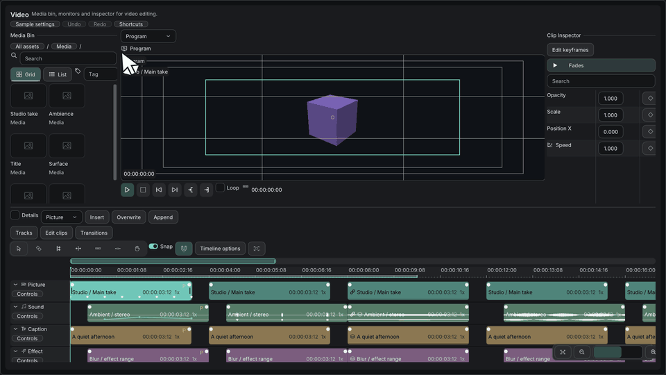

# Timeline editing

[日本語](タイムライン編集.md) · [Documentation index](../README.md) · [Tutorial: build a timeline](../tutorials/build-timeline.md)

The `imkit::video` timeline shows tracks and clips and reports edits as events. Implement the optional `TimelineEditingProvider` to enable independent clip fades, cut transitions, rectangular selection, and validated moves between tracks. Without the provider, the older transition controls remain. The provider, the borrowed views, the clipboard and the Undo history belong to your application.

## Input

| Target | Gesture | Result |
| --- | --- | --- |
| Fade | Drag either upper clip handle, including from zero length | Creates or resizes the fade. Right-click the handle to set the duration, choose Linear, Ease in or Ease out, or remove it |
| Transition | Drag Dissolve or Crossfade from `TransitionShelf` onto an adjacent cut | Inserts it. Drag the band to resize it, and use its context menu to set the duration or remove it. Dissolve is for video and Crossfade for audio. Video also offers Dip to black (`TransitionKind::Fade`). The provider's media-handle limit bounds the initial one-second duration and later edits |
| Clip selection | Drag on empty space | Selects the clips it touches. Shift adds and Ctrl toggles |
| Clip move | Drag a selected clip | Keeps the selection and moves every member by the same track offset. The destination callback maps each member, and `canMove` validates the whole set |
| Track selection | Click a track name | Selects the row. Shift adds and Ctrl toggles |
| Track reorder | Drag a selected name onto another name | Inserts the selected rows before it, in their original order. The upper half of a name inserts before the row and the lower half after it. With a `trackAfter` callback, the lower half of the last row appends |
| Track menu | The Tracks menu | Adds, duplicates and removes tracks. Removing a non-empty track asks for confirmation |
| Zoom | Ctrl + wheel, or `+` / `-` | Zooms about the pointer, or about the view center for the keys |
| Scroll | Wheel, Shift + wheel, middle-button drag | Scrolls vertically, scrolls horizontally, and pans horizontally. An active gesture also scrolls at the viewport edges |
| Navigate | Fit, Fit selection, overview range handles | Explicit navigation |
| Clipboard | Edit clips menu | Sends Copy, Cut and Paste requests. Paste uses the playhead and the active track and keeps relative time and track offsets. You implement Insert or Overwrite and reject incompatible destinations atomically |

## Event contract

| Event | Target and fields |
| --- | --- |
| `ClipFades` | The clip. `first` and `last` are the in and out durations in ticks. `x` and `y` are `FadeCurve` values |
| `CutTransition` | The left clip. `parent` is the right clip, `first` is the total duration and `x` is the `TransitionKind`. A duration of 0 removes the transition |
| `TrackEdit` | `offset` is the `TrackAction`. `parent` is the track to insert before (0 appends). `x` is the `TrackKind` when adding |
| `Clipboard` | `offset` is the `ClipboardAction`, `first` is the playhead, `parent` is the destination track and `x` is the `PlacementMode` |

A cut transition must stay on adjacent clips of the same unlocked track, with enough source media on both sides. `EvaluateFade` evaluates the clip-local fade gain. It does not decode media or apply an effect.

The timeline draws and reports. Compositing, media decoding, saving and Undo/Redo belong to your application.

Public structures gain fields at the end. Rebuild every consumer, because binary compatibility with previously compiled structures is not promised. Existing enum values and function signatures keep their meanings, and the backend and Dear ImGui version do not change.

## Verification

The Gallery's Video page lets you try the editing by hand. `--verify-timeline-ui` runs native OpenGL checks through the public IO: fade creation, preview and commit, Undo, multi-track selection, and append and reorder. Its 100,000-clip case keeps the visible-row and clip queries small (under 64 rows and 1,000 clips per inspected frame).

These checks do not establish native OS and IME behaviour, real media processing or integration into another application. [Validation](../reference/validation.md) lists what was and was not run.
