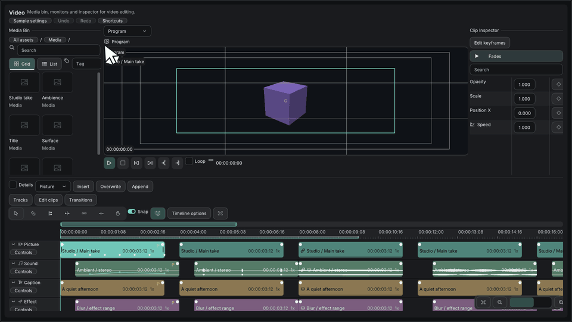

# タイムライン編集

[English](timeline-editing.md) · [目次](../目次.md) · [チュートリアル: タイムラインを作る](../tutorials/タイムラインの作成.md)

`imkit::video`のタイムラインは、トラックとクリップを表示し、編集をイベントとして報告します。任意の`TimelineEditingProvider`を実装すると、クリップごとに独立したフェード、カットのトランジション、矩形選択、トラック間の検証つきの移動が使えます。プロバイダーがないときは、従来のトランジションの操作が残ります。プロバイダー、借用したビュー、クリップボード、Undoの履歴は、アプリが持ちます。

## 入力

| 対象 | 操作 | 結果 |
| --- | --- | --- |
| フェード | クリップの上側のハンドルをドラッグ。長さ0からでもよい | フェードを作成または変更します。ハンドルを右クリックすると、長さの設定、Linear、Ease in、Ease outの選択、削除ができます |
| トランジション | `TransitionShelf`から、隣り合うカットへ、DissolveまたはCrossfadeをドラッグ | 挿入します。帯をドラッグして大きさを変え、コンテキストメニューで長さの設定や削除をします。Dissolveはビデオ用、Crossfadeはオーディオ用です。ビデオでは、Dip to black（`TransitionKind::Fade`）も選べます。最初の1秒の長さと、その後の編集は、プロバイダーが返す素材の余白の範囲に収まります |
| クリップの選択 | 何もない場所をドラッグ | 触れたクリップを選択します。Shiftで追加し、Ctrlで切り替えます |
| クリップの移動 | 選択したクリップをドラッグ | 選択を保ち、すべてのメンバーを同じトラックの差で動かします。移動先のコールバックが各メンバーを対応づけ、`canMove`が全体を検証します |
| トラックの選択 | トラック名をクリック | 行を選択します。Shiftで追加し、Ctrlで切り替えます |
| トラックの並べ替え | 選択した名前を、別の名前へドラッグ | 選択した行を、元の順序のまま、その前に挿入します。名前の上半分は行の前に、下半分は行の後ろに挿入します。`trackAfter`コールバックがあれば、最後の行の下半分は、末尾に追加します |
| トラックのメニュー | Tracksメニュー | トラックの追加、複製、削除を行います。空でないトラックの削除は、確認が出ます |
| ズーム | Ctrl + ホイール、または`+` / `-` | ポインターを中心に、キーの場合は表示の中央を中心に、ズームします |
| スクロール | ホイール、Shift + ホイール、中ボタンのドラッグ | 縦のスクロール、横のスクロール、横のパンです。操作の途中は、表示領域の端でもスクロールします |
| 表示の移動 | Fit、Fit selection、概要の範囲ハンドル | 表示範囲を、明示的に変える操作です |
| クリップボード | Edit clipsメニュー | Copy、Cut、Pasteの要求を送ります。Pasteは、再生ヘッドと有効なトラックを使い、相対的な時間とトラックの差を保ちます。InsertまたはOverwriteはアプリが実装し、合わない移動先は、まとめて拒否します |

## イベントの契約

| イベント | 対象とフィールド |
| --- | --- |
| `ClipFades` | 対象はクリップ。`first`と`last`は、イン、アウトの長さ（tick）。`x`と`y`は、`FadeCurve`の値 |
| `CutTransition` | 対象は左のクリップ。`parent`は右のクリップ、`first`は全体の長さ、`x`は`TransitionKind`。長さ0は、トランジションの削除 |
| `TrackEdit` | `offset`は`TrackAction`。`parent`は、その前に挿入するトラック（0なら末尾）。追加のときの`x`は`TrackKind` |
| `Clipboard` | `offset`は`ClipboardAction`、`first`は再生ヘッド、`parent`は移動先のトラック、`x`は`PlacementMode` |

カットのトランジションは、同じ、ロックされていないトラックの、隣り合うクリップに掛け、両側に十分な素材が必要です。`EvaluateFade`は、クリップ内のフェードのゲインを計算します。メディアのデコードや効果の適用はしません。

タイムラインは、描画と報告だけを行います。合成、メディアのデコード、保存、Undo/Redoは、アプリが担当します。

公開構造体には、末尾にフィールドが加わります。以前にコンパイルした構造体とのバイナリ互換性は、保証しないので、利用側をすべて再ビルドしてください。既存のenumの値と関数のシグネチャの意味は変わらず、バックエンドとDear ImGuiのバージョンも変わりません。

## 検証

Galleryの「Video」画面で、手で編集を試せます。`--verify-timeline-ui`は、公開IOを通して、ネイティブのOpenGLの確認を行います。フェードの作成、プレビューと確定、Undo、複数トラックの選択、追加と並べ替えが対象です。10万クリップの場合も、見えている行とクリップの問い合わせは、小さく保たれます（確認した1フレームあたり、64行未満、1,000クリップ未満）。

これらの確認では、ネイティブのOSとIMEの動作、実際のメディア処理、ほかのアプリへの統合は、確かめていません。実施した内容と、していない内容は、[検証記録](../reference/検証記録.md)にあります。
