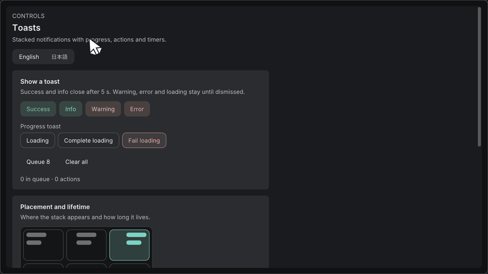

# トースト

[English](toasts.md) · [ワークフローコンポーネント](ワークフローコンポーネント.md)

`ToastViewport` は、ホストウィンドウが属するviewportに色付きカードを表示します。カードが出るときにフォーカスは奪いません。`imkit/toast.h` または `imkit/imkit.h` をincludeします。既存の `ToastRegion` は変わりません。状態、本文、context、font、renderer、実処理はホストが持ちます。React依存、グローバル管理、worker、永続化は導入しません。

## 色付きカード

```cpp
// ホストがフレームをまたいで保持します。
imkit::ToastViewportState state;
std::vector<imkit::ToastView> queue;
queue.push_back({1, "読み込み完了", "12件のファイルを読み込みました", imkit::FeedbackKind::Success});
// ホストのウィンドウとテーマscope内で、毎フレーム1回呼びます。
std::array<imkit::ToastEvent, 16> storage{};
imkit::ToastEventBuffer events{storage};
imkit::ToastViewportOptions layout;
layout.position = imkit::ToastPosition::TopRight;
imkit::ToastViewport("notifications", queue, state, ImGui::GetTime(), events,
                     layout, {&theme});
for (std::size_t i = 0; i < events.count; ++i) {
    const auto event = storage[i];
    if (event.kind == imkit::ToastEventKind::Action) {
        // event.idからホストの実処理を実行します。
    } else {
        std::erase_if(queue, [&](const auto& item) { return item.id == event.id; });
    }
}
```

例には `<array>`、`<vector>`、`<algorithm>` が必要です。使うときの規則です。

- 文字列はUTF-8で借用します。描画中は、記憶領域を有効に保ちます。
- IDは、0以外の一意な値にします。
- 状態は、viewportとcontextごとに1つ持ちます。contextを再利用する前に `Reset()` します。
- 呼び出しはUIスレッドで行います。workerの結果は、ホストが受け渡します。
- 通知と重なるホストウィンドウは、`ImGuiWindowFlags_NoBringToFrontOnFocus` を付けて作り、そのあとで通知を描画します。たとえば `ImGui::Begin("App", nullptr, ImGuiWindowFlags_NoBringToFrontOnFocus)` です。付けないと、ホストのクリックで、既存の通知より前面に出ることがあります。
- 通知は、公開APIの通常のウィンドウです。内部APIで描画順を強制したり、フォーカスを奪ったりはしません。新しく作られる重なるウィンドウとモーダルダイアログは、Dear ImGuiの描画順と入力の規則に従います。

## 表示時間と待機

| 場合 | 動作 |
| --- | --- |
| `duration` が負 | 既定値。成功と情報は5秒、警告とエラーは残る |
| `duration` が0 | 残り続ける |
| `duration` が正 | その秒数 |
| `Loading` の段階 | 常に残る |
| ホバー、キーボードフォーカス | 期限を止める。待機中のカードは時間を消費しない |

描画は毎フレーム1回です。`UpdateToastViewport` は、描画せずに時間だけを進めます。同じ状態を、同じフレームで描画する場合は、併用しません。

**進捗。** `phase=ToastPhase::Loading` にします。細い丸角のバーの外側に、工程名 `stage`、状態、割合または `progressText` を表示します。`progress` が負または非有限値なら不定表示になり、短い区間が動くのは、状態が `Running` のときだけです。`Paused` と終了状態では動きません。それ以外の値は、0〜1に制限します。

**完了。** 同じIDを、`phase=Message`、`Succeeded` または `Failed`、成功かエラーの種類に更新します。phase、kind、durationを変えると、期限を開始し直しますが、挿入順は変わりません。本文と進捗の更新では、期限を再開しません。

末尾に追加した `ToastView::stage`、`progressText`、`status` は既定値を持つので、既存のaggregate initializerの項目順と動作は保たれます。

```cpp
toast.phase = imkit::ToastPhase::Loading;
toast.stage = "内容を確認しています";
toast.progress = fraction; // 負値・非有限値は不定表示
toast.status = imkit::ProgressStatus::Running;
toast.action = "詳細を表示"; // ToastEvent::Action と通知IDを返します
// 完了後も同じIDを使い、phase=Message と Succeeded/Failed を設定します。
```

**待機の上限**

- 新しい通知は、指定した辺に近い位置に置きます。表示上限を超えた通知は待機します。
- IDが重複したら、最後の要素を採用します。
- 状態は、ホストの削除を待つ期限切れのIDを含めて、64件まで保持します。超えた分は `state.overflow` で知らせ、空きができると追跡を始めます。
- 期限切れのIDは、削除されるか、明示的に更新されるまで、再表示しません。
- 要求バッファが足りないときは、`events.overflow` で知らせます。届かなかった期限切れの要求は、次のフレーム以降に再送します。操作や閉じるの要求が入らなかったときは、もう一度操作が必要です。
- 要求の件数は、毎フレーム初期化します。

## 配置とカスタマイズ

| 設定 | 動作 |
| --- | --- |
| `ToastPosition` | 上下と、左・中央・右の6位置。既定は `TopRight`、`maximum=4` |
| 幅が0 | フォント基準の幅 |
| 余白・間隔が負 | テーマ適用後のstyleから導く |
| 寸法の上限 | カードの寸法と表示件数をviewportの作業領域に収める。単独で高さを超えるカードは縦にスクロールする |

**見た目。** カードは、持ち上げた面に、状態色のアクセントバーとアイコンを付けて表示します。状態色は、セマンティックトークンから作り、文字はテーマの文字コントラストを保ちます。下端の細い線が、残りの表示時間を示し、ホバーやフォーカスの間は止まります。角丸、出現時のスライドとフェード、動きを減らす設定は、テーマに従います。動きを減らす設定では、スライド、フェード、残り時間の補間、不定進捗の区間の移動、スピナーの回転を止めます。

**ホストからの入力。** テーマ、ロケール、セマンティックの公開は、`ComponentOptions` で渡します。閉じるボタンの読み上げ名には、`dismiss` キーを使います。見出し、説明、操作のラベルは、ホストが指定します。ボタンは標準のキーボード操作に対応し、グローバルなショートカットや自動のフォーカス移動は設けません。

**操作。** `action` でボタンを指定し、`actionDisabled` で無効にし、`dismissible` で閉じるボタンの有無を決めます。`ToastEvent` は、`Action`、`Dismiss`、`Expired` を区別します。操作のあとに通知を削除するか更新するかは、ホストが決めます。処理のキャンセルも、ホストの担当です。

## Galleryと検証

**Toasts**（page 20）に、6位置、期限の指定、連続通知、同じIDでの成功・エラー更新、進捗あり・なし、詳細を表示する操作、英日の例を用意しています。**Appearance** で、テーマ、密度、コントラスト、動きを減らす設定を変えられます。



`imkit.toast` は、期限、停止、待機、更新、バッファの上限、重複ID、配置、公開のマウス入力の要求を検証します。`imkit.toast_api_compile` と外部のconsumerは、公開の署名を確かめます。GalleryのGPUキャプチャは、ネイティブのOS/IME、読み上げ、複数モニターのDPI、macOSの受け入れとは別です。
