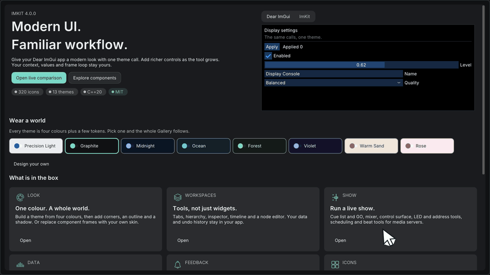

# 導入ガイド

[English](getting-started.md) · [目次](../目次.md) · [仕組みと設計](仕組みと設計思想.md)

ImKitは、すでにDear ImGuiを使っているアプリにリンクする、C++20の静的ライブラリです。Context、レンダラー、バックエンド、フレームループは作りません。このページでは、新しいプロジェクトから、テーマ付きの最初のフレームを描くところまでを説明します。

## 必要環境

| 項目 | 要件 |
| --- | --- |
| C++ | C++20 |
| Dear ImGui | `docking`ブランチのコミット `367b2c24f399988ddafc0bb4628da0106bcc09be`（1.93.0 WIP） |
| ビルドシステム | CMake 3.20以降 |
| 対応環境 | Windows x64 / Arm64（MSVC）、macOS 15以降（arm64 / x86_64、Apple Clang） |

Dear ImGuiのソースは、アプリが用意します。リビジョンを固定している理由は、[依存関係](../architecture/依存関係.md)を参照してください。

## 始め方を選ぶ

| 目的 | 進み方 |
| --- | --- |
| ImKitの見た目を確かめる | [Galleryを動かす](#galleryを動かす) |
| CMakeプロジェクトで使う | [ソースから組み込む](#ソースから組み込む) |
| ビルド済みのライブラリを使う | [SDKパッケージを使う](#sdkパッケージを使う) |

## Galleryを動かす

お使いの環境向けの[最新のリリースパッケージ](https://github.com/AokiMotohide/imgui-modern-kit/releases/latest)をダウンロードして、展開します。

- **Windows:** `bin/`にある`imkit_gallery.exe`と`imkit_node_editor_gallery.exe`を実行します。
- **macOS:** 2つの`.app`を開きます。Apple SiliconとIntelの両方で1つのアーカイブを使うときは、Universal 2のパッケージを選びます。パッケージは、署名も公証もしていません。



Galleryは、アプリがリンクするのと同じ公開部品だけで作られています。`examples/gallery/`のソースは、動く参照実装として使えます。

## ソースから組み込む

1. プロジェクトで、Dear ImGuiをCMakeのターゲットとしてビルドします。
2. そのターゲット名を、`IMKIT_IMGUI_TARGET`に指定します。
3. `add_subdirectory`でImKitを追加します。
4. アプリに`imkit::imkit`をリンクします。

```cmake
add_library(host_imgui STATIC
    ${IMGUI_SOURCE_DIR}/imgui.cpp
    ${IMGUI_SOURCE_DIR}/imgui_draw.cpp
    ${IMGUI_SOURCE_DIR}/imgui_tables.cpp
    ${IMGUI_SOURCE_DIR}/imgui_widgets.cpp)
target_include_directories(host_imgui PUBLIC ${IMGUI_SOURCE_DIR})

set(IMKIT_IMGUI_TARGET host_imgui)
set(IMKIT_BUILD_GALLERY OFF)          # 組み込むときは、サンプルとテストを省く
set(IMKIT_BUILD_DESIGN_GALLERY OFF)
set(IMKIT_BUILD_TESTS OFF)
add_subdirectory(external/imgui-modern-kit)

target_link_libraries(your_app PRIVATE imkit::imkit)
imkit_copy_font_assets(your_app "assets/fonts")   # 任意
```

`IMKIT_IMGUI_TARGET`には、すでにあるターゲットを指定します。ImKitは何もダウンロードせず、Dear ImGuiもコンパイルしません。`imkit_copy_font_assets`は、任意のInterとNoto Sans JPのファイルを、実行ファイルの隣へコピーするだけです。フォントアトラスへの読み込みと、アトラスとContextの寿命の管理は、アプリが行います。

### 任意のモジュール

| 必要なもの | リンクするターゲット |
| --- | --- |
| テーマ、基本部品、Workflow、グラフ、PTZ、アイコン | `imkit::imkit` |
| タイムライン、カーブ、インスペクター、プレビューモニター | `imkit::editor_suite`（範囲を絞るなら`imkit::video`、`imkit::cg`） |
| ノードグラフ | `imkit::node_editor` |
| ショーの操作 | `imkit::show` |
| 独自のタイトルバー | `imkit::window_frame_win32` / `imkit::window_frame_macos` |
| OpenGLまたはMetalのプレビュー | `imkit::preview_opengl3` / `imkit::preview_metal` |

## 最初のフレームを描く

有効なContext上で、`NewFrame`より前にテーマを適用し、通常のウィンドウの中で描きます。

```cpp
#include <imkit/imkit.h>

// Contextができたあとに1回
imkit::Theme theme = imkit::MakeTheme(imkit::ThemePreset::PrecisionDark);
// theme.fonts = {regularFont, emphasisFont};   // 任意。借用ポインター

// 毎フレーム
imkit::ApplyTheme(theme);          // ImGui::NewFrame() より前
ImGui::NewFrame();

if (imkit::Begin("Settings")) {
    imkit::TextUnformatted("ImKit is running");
    if (imkit::ActionButton("Test", imkit::ActionVariant::Primary)) {
        // アプリの処理
    }
}
imkit::End();

ImGui::Render();
// バックエンドが ImGui::GetDrawData() を描画する
```

- `ApplyTheme(theme, scale)`には、アプリのスケールを渡します。既定は125%で、指定できる範囲は50%から250%です。
- 1つのウィンドウだけ別のテーマにするときは、部品を描く前に`imkit::ThemeScope`を作ります。同じContextで、そのContextを破棄する前に、スコープを破棄します。

## SDKパッケージを使う

インストール済みのSDKは、コンパイラ、CRT、アーキテクチャ、Dear ImGuiのリビジョン、`imconfig.h`のすべてがパッケージと一致すると確認できたときだけ使います。確認したことを示すフラグは、自分で設定します。

```cmake
set(IMKIT_IMGUI_TARGET host_imgui)
set(CMAKE_PREFIX_PATH "path/to/imkit-sdk" ${CMAKE_PREFIX_PATH})
set(IMKIT_SDK_ABI_CONFIRMED ON)
find_package(imkit 4.1 CONFIG REQUIRED)
target_link_libraries(your_app PRIVATE imkit::imkit)
```

条件が1つでも違うときは、ソースからビルドしてください。パッケージには、Dear ImGuiは入っていません。

## 次に読む

| 文書 | 内容 |
| --- | --- |
| [仕組みと設計](仕組みと設計思想.md) | フレームの動きと、だれが何を持つか |
| [最初のアプリを作る](../tutorials/最初のアプリの作成.md) | 完全な手順 |
| [テーマ](../architecture/テーマ.md) | テーマの選び方と調整 |
| [基本コンポーネント](../components/基本コンポーネント.md) | 部品と、設定パネルの完全な例 |
| [Galleryガイド](ギャラリーガイド.md) | 各部品のソースの探し方 |
| [トラブルシューティング](../reference/トラブルシューティング.md) | ビルド、リンク、実行時のエラー |
