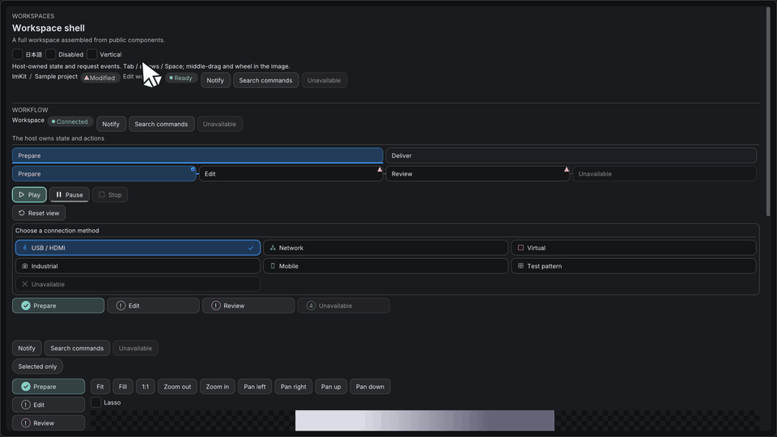

# ImKit 3.3追加API

[English](v3.3-api.md) · [Workflow部品](../components/ワークフローコンポーネント.md) · [トースト](../components/トースト.md)

進捗率、現在の工程、操作を同じ表示規則でまとめます。工程・進捗値・worker・通知キューの所有者はホストです。部品はworkerを起動せず、操作要求を返します。



## 使用例

負の値と非有限値は未確定の進捗です。確定値は0〜1へ制限されます。`Running`の未確定値だけが動き、`Paused`と終端状態は静止します。状態は`Queued`・`Running`・`Paused`・`Succeeded`・`Failed`・`Cancelled`です。

```cpp
#include <imkit/imkit.h>
#include <imkit/toast.h>
#include <array>

// In an existing host frame; all referenced strings/arrays live through the draw.
void DrawTask(float fraction) {
    using namespace imkit;
    ProgressTrackView track;
    track.fraction = fraction;
    track.label = "Export";
    track.supplemental = "12 files";
    ProgressTrack("export-track", track);

    const std::array<StageProgressItem, 3> stages{{
        {1, "Prepare", ProgressStatus::Succeeded},
        {2, "Export", ProgressStatus::Running},
        {3, "Verify", ProgressStatus::Queued}}};
    StageProgress("export-stages", StageProgressView{stages, 2});
    const std::array<Command, 1> commands{{{42, "Cancel"}}};
    TaskProgressCardView task;
    task.id = 10;
    task.title = "Export files";
    task.stage = "Writing output";
    task.fraction = fraction;
    task.operations = commands;
    if (TaskProgressCard("export-task", task) == 42) {
        // The host requests cancellation of its own worker.
    }
}

// Update a host-owned notification, then pass it to ToastViewport as usual.
void UpdateToast(imkit::ToastView& toast, float fraction) {
    toast.phase = imkit::ToastPhase::Loading;
    toast.stage = "Writing output";
    toast.progress = fraction;
    toast.progressText = "12 / 20 files";
    toast.status = imkit::ProgressStatus::Running;
}
```

## 公開宣言

Headers: `<imkit/patterns.h>`, `<imkit/workflow.h>`, `<imkit/toast.h>`

```cpp
enum class ProgressStatus { Queued, Running, Paused, Succeeded, Failed, Cancelled };
struct ProgressTrackView {
    float fraction=-1; // Negative or nonfinite values are indeterminate.
    ProgressStatus status=ProgressStatus::Running;
    const char* label="";
    const char* supplemental="";
    const char* valueText=""; // Optional host-formatted value; otherwise a percentage is shown when determinate.
};

struct StageProgressItem {
    StableId id=0;
    const char* label="";
    ProgressStatus status=ProgressStatus::Queued;
};
struct StageProgressView {
    std::span<const StageProgressItem> stages{};
    StableId current=0;
};
struct TaskProgressCardView {
    StableId id=0;
    const char* title="";
    const char* stage="";
    const char* description="";
    float fraction=-1;
    ProgressStatus status=ProgressStatus::Running;
    const char* supplemental="";
    std::span<const Command> operations{};
};
struct TaskProgressCardOptions {
    bool compact=false;
};

void ProgressTrack(const char* id, float fraction,
                   ProgressStatus status=ProgressStatus::Running, ComponentOptions options={});
void ProgressTrack(const char* id, const ProgressTrackView& view, ComponentOptions options={});
void StageProgress(const char* id, const StageProgressView& view, ComponentOptions options={});
StableId TaskProgressCard(const char* id, const TaskProgressCardView& view,
                          TaskProgressCardOptions layout={}, ComponentOptions options={});
```

## 所有権と互換性

文字列とspanは非所有参照です。描画呼び出しが終わるまで有効な領域を渡してください。IDは表示内で安定かつ一意に保ち、ImGuiのUIスレッドで描画します。`StageProgress`は工程を変更せず、`TaskProgressCard`は押された操作のID、操作がなければ0を返します。`compact=true`で狭い領域向けの表示になります。

`ToastView`の末尾に`stage`・`progressText`・`status`を追加しました。既存の公開関数の引数・既定値は維持していますが、構造体のレイアウトが変わります。3.3ヘッダーでホストとImKit静的ライブラリを再コンパイルし、3.2のobjectと混在させないでください。Dear ImGuiの固定revisionと設定一致の要件、依存関係は変わりません。

上のGIFはWindows native GalleryのOpenGL backbufferから取得しています。公開Dear ImGui IOによる操作は、物理OS入力・IME・実機受入の検証とは区別します。
