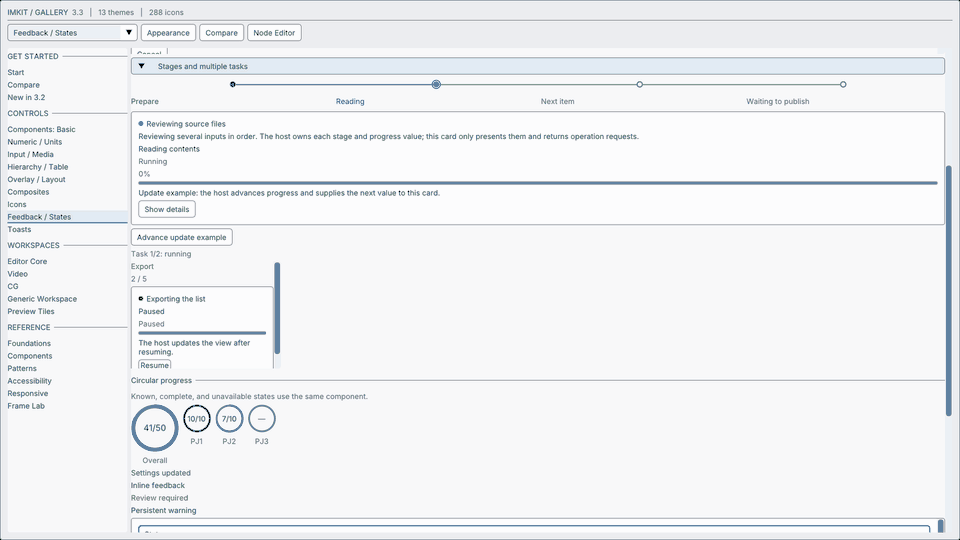

# ImKit 3.3 additions

[日本語](3.3追加API.md) · [Workflow](../components/workflow-components.md) · [Toasts](../components/toasts.md)

Present progress, the current stage and available operations consistently. The host owns stages, values, workers and notification queues. These components do not start workers; they return operation requests.



## Example

Negative or nonfinite fractions mean indeterminate progress. Determinate values are clamped to 0–1. Only indeterminate `Running` progress animates; `Paused` and terminal states remain still. States are `Queued`, `Running`, `Paused`, `Succeeded`, `Failed` and `Cancelled`.

```cpp
#include <imkit/imkit.h>
#include <imkit/toast.h>
#include <array>

// In an existing host frame; all referenced strings/arrays live through the draw.
void DrawTask(float fraction) {
    using namespace imkit;
    ProgressTrackView track;
    track.fraction = fraction;
    track.label = "Export";
    track.supplemental = "12 files";
    ProgressTrack("export-track", track);

    const std::array<StageProgressItem, 3> stages{{
        {1, "Prepare", ProgressStatus::Succeeded},
        {2, "Export", ProgressStatus::Running},
        {3, "Verify", ProgressStatus::Queued}}};
    StageProgress("export-stages", StageProgressView{stages, 2});
    const std::array<Command, 1> commands{{{42, "Cancel"}}};
    TaskProgressCardView task;
    task.id = 10;
    task.title = "Export files";
    task.stage = "Writing output";
    task.fraction = fraction;
    task.operations = commands;
    if (TaskProgressCard("export-task", task) == 42) {
        // The host requests cancellation of its own worker.
    }
}

// Update a host-owned notification, then pass it to ToastViewport as usual.
void UpdateToast(imkit::ToastView& toast, float fraction) {
    toast.phase = imkit::ToastPhase::Loading;
    toast.stage = "Writing output";
    toast.progress = fraction;
    toast.progressText = "12 / 20 files";
    toast.status = imkit::ProgressStatus::Running;
}
```

## Public declarations

Headers: `<imkit/patterns.h>`, `<imkit/workflow.h>`, `<imkit/toast.h>`

```cpp
enum class ProgressStatus { Queued, Running, Paused, Succeeded, Failed, Cancelled };
struct ProgressTrackView {
    float fraction=-1; // Negative or nonfinite values are indeterminate.
    ProgressStatus status=ProgressStatus::Running;
    const char* label="";
    const char* supplemental="";
    const char* valueText=""; // Optional host-formatted value; otherwise a percentage is shown when determinate.
};

struct StageProgressItem {
    StableId id=0;
    const char* label="";
    ProgressStatus status=ProgressStatus::Queued;
};
struct StageProgressView {
    std::span<const StageProgressItem> stages{};
    StableId current=0;
};
struct TaskProgressCardView {
    StableId id=0;
    const char* title="";
    const char* stage="";
    const char* description="";
    float fraction=-1;
    ProgressStatus status=ProgressStatus::Running;
    const char* supplemental="";
    std::span<const Command> operations{};
};
struct TaskProgressCardOptions {
    bool compact=false;
};

void ProgressTrack(const char* id, float fraction,
                   ProgressStatus status=ProgressStatus::Running, ComponentOptions options={});
void ProgressTrack(const char* id, const ProgressTrackView& view, ComponentOptions options={});
void StageProgress(const char* id, const StageProgressView& view, ComponentOptions options={});
StableId TaskProgressCard(const char* id, const TaskProgressCardView& view,
                          TaskProgressCardOptions layout={}, ComponentOptions options={});
```

## Ownership and compatibility

Strings and spans are borrowed: keep their storage valid through each draw call. IDs must be stable and unique within the view. Draw on the ImGui UI thread. `StageProgress` does not change the stage. `TaskProgressCard` returns the selected operation ID, or zero; `compact=true` selects a compact presentation.

`ToastView` appends `stage`, `progressText` and `status`. Existing function arguments and defaults remain, but the structure layout changes. Recompile the host and ImKit static libraries with matching 3.3 headers. Do not mix 3.2 objects and 3.3 structures. The pinned Dear ImGui revision, matching-configuration requirement and dependencies are unchanged.

The GIF is captured from the Windows native Gallery OpenGL backbuffer. Public Dear ImGui IO operation is distinct from physical OS input, IME and hardware acceptance.
