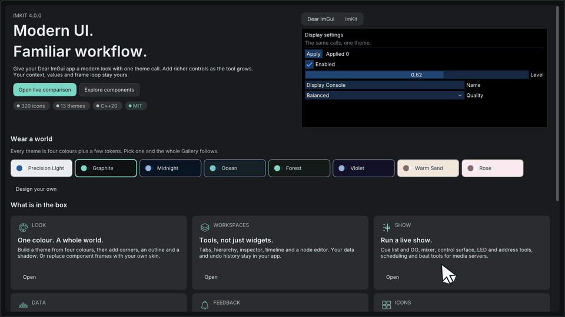
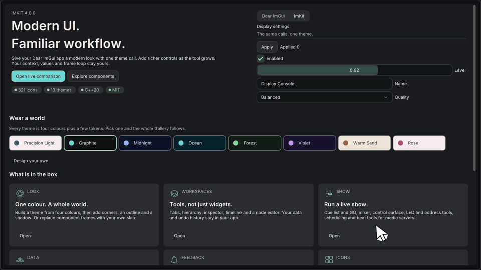

# Build your first app

[日本語](最初のアプリの作成.md) · [Documentation index](../README.md) · [How ImKit works](../getting-started/how-it-works.md)

This tutorial builds the smallest program that draws ImKit controls: one window with a toggle, a status badge and a button. It runs one frame on the CPU, so it needs no window, GPU or image loader. At the end you will know where the Dear ImGui context, the theme and your own state live.



## Before you start

- A C++20 toolchain and CMake 3.20 or newer.
- Dear ImGui at the pinned commit `367b2c24f399988ddafc0bb4628da0106bcc09be`, built as a CMake target (see [Getting started](../getting-started/getting-started.md)).
- ImKit linked as `imkit::imkit`.

## Step 1: Create the context

ImKit never creates a Dear ImGui context. Your application creates it once at startup and destroys it at shutdown.

```cpp
#include <cstdio>
#include <imgui.h>
#include <imkit/imkit.h>

int main() {
    IMGUI_CHECKVERSION();
    ImGui::CreateContext();
    ImGuiIO& io = ImGui::GetIO();
    io.DisplaySize = {640, 480};    // a real app gets this from its window
    io.DeltaTime = 1.0f / 60.0f;    // and this from its frame timer
    io.IniFilename = nullptr;       // no settings file
    io.Fonts->AddFontDefault();

    // No renderer backend runs here, so build the font atlas by hand.
    // A real backend does this for you.
    unsigned char* pixels = nullptr;
    int width = 0, height = 0;
    io.Fonts->GetTexDataAsRGBA32(&pixels, &width, &height);
```

`io.IniFilename = nullptr` stops Dear ImGui from reading or writing `imgui.ini`.

## Step 2: Make a theme

A theme is a plain value. `MakeTheme` returns a copy that your application keeps. ImKit holds no global current theme.

```cpp
    imkit::Theme theme = imkit::MakeTheme(imkit::ThemePreset::Ocean);
```



`ThemePreset::Ocean` is one of the built-in presets. See [Themes](../architecture/themes.md) for the list and for building your own.

## Step 3: Keep your own state

The values the controls edit belong to your application.

```cpp
    bool notifications = true;
    int counter = 0;
```

## Step 4: Draw a frame

Apply the theme on the live context before `NewFrame`, then draw between `NewFrame` and `Render`.

```cpp
    imkit::ApplyTheme(theme);       // before ImGui::NewFrame()
    ImGui::NewFrame();

    ImGui::SetNextWindowPos({20, 20});
    ImGui::SetNextWindowSize({320, 200});
    if (imkit::Begin("Settings", nullptr, ImGuiWindowFlags_NoResize)) {
        imkit::Toggle("Notifications", &notifications);
        imkit::StatusBadge(notifications ? "Active" : "Off",
                           notifications ? imkit::StatusKind::Success : imkit::StatusKind::Neutral);
        if (imkit::ActionButton("Add one", imkit::ActionVariant::Primary)) {
            ++counter;              // runs on the frame where the button is pressed
        }
        ImGui::SameLine();
        ImGui::Text("Count: %d", counter);
    }
    imkit::End();

    ImGui::Render();
```

| Call | What it does |
| --- | --- |
| `imkit::Toggle` | Reads and writes your `bool`, and returns true on the frame it changes |
| `imkit::StatusBadge` | Draws a status chip. It returns nothing |
| `imkit::ActionButton` | Returns true on the frame the button is pressed. Your code decides what happens |
| `imkit::Begin` / `imkit::End` | Dear ImGui's `Begin` / `End`. Always call `End`, even when `Begin` returns false |

## Step 5: Read the result and clean up

```cpp
    const ImDrawData* draw = ImGui::GetDrawData();
    std::printf("draw lists: %d, vertices: %d, indices: %d\n",
                draw->CmdListsCount, draw->TotalVtxCount, draw->TotalIdxCount);

    ImGui::DestroyContext();
    return 0;
}
```

Build and run it. Any output with non-zero vertex and index counts means the frame was drawn:

```text
draw lists: 1, vertices: 418, indices: 1281
```

The numbers depend on the default font. This program has no backend, so nothing reaches a screen and the button cannot be pressed. It confirms that the context, the theme and the controls work together.

## Show it in a window

Replace the single frame with your application's loop and let a backend submit `ImGui::GetDrawData()`. The Gallery does exactly this with GLFW and OpenGL3 or Metal. Read `examples/gallery/main.cpp`, and see the [Gallery guide](../getting-started/gallery.md) for how to build and run it.

## Common mistakes

| Mistake | Effect | Fix |
| --- | --- | --- |
| Calling `ApplyTheme` after `NewFrame` | The current frame uses the previous style | Call it before `ImGui::NewFrame()` |
| Skipping `imkit::End()` | The window scope is left open | Call `End` once for every `Begin` |
| Expecting ImKit to change your data | Nothing changes except the values you passed by pointer | Apply returned results to your own model |
| Destroying the context while a `ThemeScope` is alive | Assertion in the scope's destructor | End the scope before `DestroyContext()` |

## Next

- [Build a settings screen](build-settings-screen.md): a form built from ImKit components.
- [Build a node editor](build-node-editor.md): draw a graph and collect edit requests.
- [Build a timeline](build-timeline.md): tracks, clips and edit gestures.
- [Build a custom component](custom-component.md): your own themed control.
