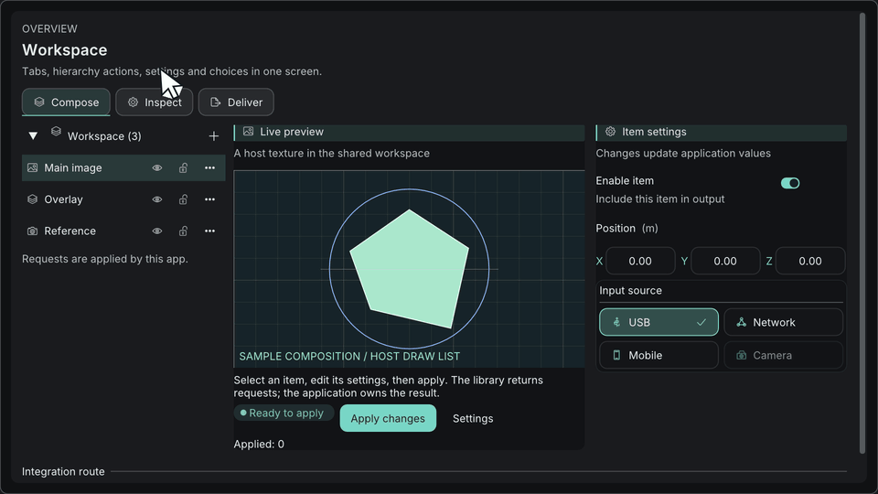

# Build a settings screen

[日本語](設定画面の作成.md) · [Documentation index](../README.md) · [How ImKit works](../getting-started/how-it-works.md)

A settings screen is a struct you own plus a column of labelled controls. The controls read and write the struct and report what the user did. Your code decides what to do with the changes. This tutorial builds a panel with a toggle, a combo, a numeric field, a text field and a Save button, then handles saving and a notification. The per-control reference is in [Components](../components/components.md).



## The pattern

1. **State lives in your struct.** One plain struct holds every setting. ImKit never stores it.
2. **One control per labelled row.** `BeginSettingRow` draws the label in the first column and your control in the second.
3. **The panel returns a request.** When the user presses Save, the panel returns true. Your code validates, saves and shows a notification.

## Before you start

You need a Dear ImGui context and a window (your application, or the Gallery), a `Theme`, and `imkit::imkit` linked.

## Step 1: Define the state

```cpp
#include <imkit/imkit.h>
#include <array>

struct DisplaySettings {
    bool enabled = true;             // toggle
    int quality = 1;                 // 0..2, chosen in the combo
    char qualitySearch[64]{};        // the combo's search buffer, kept by you
    float exposure = 0.0f;           // in EV
    char name[128] = "Main display"; // text input
    bool showSavedNotice = false;    // drives the notification
};
```

Keep `qualitySearch` alive as long as the combo is drawn, and clear it when you need to.

## Step 2: Use a setting row

```cpp
// A toggle is self-contained and needs no row.
imkit::Toggle("Enabled", &settings.enabled, {&theme});

// Other controls go in a row.
if (imkit::BeginSettingRow("exposure", "Exposure")) {
    imkit::DragFloatWithUnit("##exposure", &settings.exposure, "EV", 0.01f, -8.0f, 8.0f);
    imkit::EndSettingRow();   // only when BeginSettingRow returned true
}
```

- `BeginSettingRow(id, label, labelWidth)` lays out the label and a second column. `id` is a stable Dear ImGui ID.
- Give the control an id that starts with `##` so it has no visible label inside the row.
- Call `EndSettingRow` only when `BeginSettingRow` returned true.

## Step 3: Assemble the panel

Call this between `NewFrame()` and `Render()`.

```cpp
bool DrawDisplaySettings(DisplaySettings& settings,
                         const imkit::Theme& theme, double now) {
    imkit::ThemeScope themeScope(theme);      // the panel uses this theme, then restores the previous one
    bool saveRequested = false;

    if (imkit::Begin("Display settings")) {
        imkit::Toggle("Enabled", &settings.enabled, {&theme});

        if (imkit::BeginSettingRow("quality", "Quality")) {
            constexpr std::array<const char*, 3> labels{"Draft", "Balanced", "High"};
            imkit::SearchableCombo("##quality", &settings.quality, labels,
                                   settings.qualitySearch, sizeof(settings.qualitySearch));
            imkit::EndSettingRow();
        }

        if (imkit::BeginSettingRow("exposure", "Exposure")) {
            imkit::DragFloatWithUnit("##exposure", &settings.exposure, "EV", 0.01f, -8.0f, 8.0f);
            imkit::EndSettingRow();
        }

        imkit::InputTextWithHint("Name", "Required", settings.name, sizeof(settings.name));
        const bool invalidName = settings.name[0] == '\0';
        imkit::ValidationMessage("Enter a name before saving.", invalidName, &theme);
        imkit::BeginDisabled(invalidName);
        saveRequested = imkit::ActionButton("Save", imkit::ActionVariant::Primary,
                                            {}, {&theme});
        imkit::EndDisabled();

        if (settings.showSavedNotice &&
            imkit::NotificationCard({"saved", "Settings saved", imkit::StatusKind::Success, 0},
                                    now, &theme)) {
            settings.showSavedNotice = false;   // the user dismissed it
        }
    }
    imkit::End();                                // always pairs with Begin
    return saveRequested;
}
```

To change the kind of input, swap `SearchableCombo` for `Segmented` (a small fixed choice), use `InputScalarWithUnit` or `DragVector3WithUnit` for numbers, or add a `StatusBadge` for the current state.

## Step 4: Validate, save and notify

The panel saves nothing. When it returns true, your code does the work:

```cpp
const double now = ImGui::GetIO().Time;
if (DrawDisplaySettings(settings, theme, now)) {
    if (settings.name[0] == '\0') {
        return;                                // the button was disabled, but guard anyway
    }
    PersistDisplaySettings(settings);          // your file, database or network call
    settings.showSavedNotice = true;           // shown from the next frame
}
```

| Step | Where |
| --- | --- |
| Validate | `ValidationMessage` shows the message, and `BeginDisabled` blocks Save on the same condition. Keep the condition in one place. |
| Save | Your code, after the user presses Save. Set `showSavedNotice` only after saving succeeds, so a failed save never shows a success message. |
| Notify | `NotificationCard` returns true when the user dismisses it. An `expiresAt` of 0 keeps the card until you remove it. |

## Run it

The Gallery's settings pages use the same pattern. Build the `imkit_gallery` target to see it themed (see the [Gallery guide](../getting-started/gallery.md)). In your own application, call `DrawDisplaySettings` from your frame and handle the returned request as shown.

## Rules

- Each setting lives in exactly one field, and the control writes it.
- One control per row. Do not put a label and two controls in one row.
- Disable the action while the input is invalid, and show the message next to the field.
- Controls never open files or sockets. The panel returns, and you act.
- Pair `Begin` with `End` always, and `BeginSettingRow` with `EndSettingRow` only when it returned true.

## Next

- [Components](../components/components.md): every control in detail.
- [Build a node editor](build-node-editor.md)
- [Build a custom component](custom-component.md)
