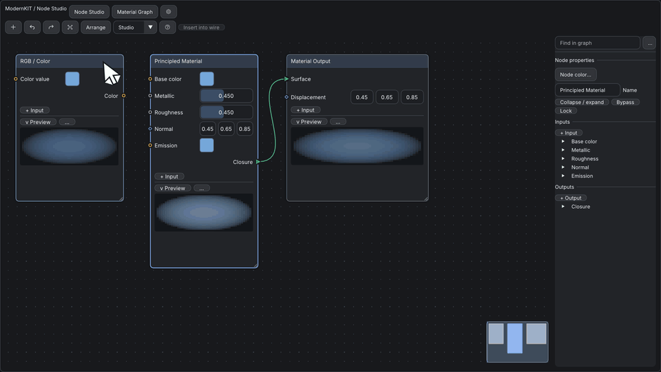

# ノードエディタを作る

[English](build-node-editor.md) · [目次](../目次.md) · [仕組みと設計](../getting-started/仕組みと設計思想.md)

Node Editorは、ImKitのグラフ用キャンバスです。任意のターゲット`imkit::node_editor`として提供します。フレームごとに、グラフのスナップショットを渡すと、ユーザーが行った編集が、要求として返ってきます。

評価エンジン、レンダラー、ファイルアクセス、グローバルな「現在のエディタ」は、ライブラリにありません。グラフを持ち、編集を適用するのは、アプリです。

このチュートリアルでは、グラフのモデルを作って描画し、移動、名前の変更、作成、削除、接続、Undo/Redoの要求を適用します。



## 基本の形

各フレームは、3つの手順です。

1. **スナップショット。** アプリのデータから`ne::GraphView`を作り、現在の`revision`を付けます。
2. **描画。** `BeginEditor`を呼び、`DrawLinks`と`DrawNodes`を呼んで、`EndEditor`を呼びます。
3. **適用。** 返された`EditRequest`を、モデルの`Apply`に渡します。

ImKitは、グラフを変更しません。要求は調べるための値で、適用してよいのは、現在のスナップショットから作られた要求だけです。

## 始める前に

- Dear ImGuiのContextとウィンドウ（アプリ、またはGallery）。
- リンクした`imkit::node_editor`。
- C++20。コードが`std::span`と`std::erase_if`を使うためです。

## 手順1: グラフを、アプリ自身のモデルに持つ

モデルは、ノード、ピン、リンク、Undoの履歴を持ちます。タイトルはモデル側の`std::string`で、スナップショットはそれを借用します。

```cpp
#include <imgui.h>
#include <imkit/imkit.h>
#include <imkit/node_editor.h>
#include <algorithm>
#include <array>
#include <span>
#include <string>
#include <vector>

namespace ne = imkit::node_editor;

// この構造体の中身は、すべてアプリのものです。
struct GraphModel {
    struct Node {
        ne::NodeId id;
        std::string title;
        ne::Point position;
        ne::Point size{240, 160};
    };
    struct Snapshot {
        std::vector<Node> nodes;
        std::vector<ne::PinView> pins;
        std::vector<ne::LinkView> links;
    };

    Snapshot data;
    std::vector<Snapshot> undo, redo;
    std::vector<ne::NodeView> nodeViews;   // 毎フレーム作り直す
    ne::GraphId graph{1};
    std::uint64_t revision = 1;            // データが変わるたびに増やす
    std::uint64_t nextId = 100;

    ne::NodeId AddNode(ne::Point position, std::string title) {
        const ne::NodeId id{nextId++};
        data.nodes.push_back({id, std::move(title), position});

        ne::PinView in;
        in.id = {nextId++};
        in.node = id;
        in.label = "In";
        in.kind = ne::PinKind::Input;
        in.side = ne::Side::Left;

        ne::PinView out;
        out.id = {nextId++};
        out.node = id;
        out.label = "Out";
        out.kind = ne::PinKind::Output;
        out.side = ne::Side::Right;

        data.pins.push_back(in);
        data.pins.push_back(out);
        return id;
    }

    Node* Find(ne::NodeId id) {
        for (Node& n : data.nodes)
            if (n.id == id) return &n;
        return nullptr;
    }

    // スナップショットはこのモデルから借用し、1フレームの間だけ有効です。
    ne::GraphView View() {
        nodeViews.clear();
        for (const Node& n : data.nodes) {
            ne::NodeView v;
            v.id = n.id;
            v.position = n.position;
            v.size = n.size;
            v.title = n.title;
            nodeViews.push_back(v);
        }
        return {graph, revision, nodeViews, data.pins, data.links};
    }
    // RemoveNode() と Apply() は、手順4で加えます。
};
```

`AddNode`は、各ノードに入力と出力のピンを1つずつ付けます。`Node`のレコードはアプリのものなので、必要なフィールドを足せます。

## 手順2: スナップショットを作る

`View()`は、モデルのvectorを借用する`GraphView`を返します。有効なのは1フレームの間です。付けた`revision`が、要求を適用してよいかを決めます。エディタは、それをすべての要求にコピーし、`Apply`は、一致しない要求を捨てます。

上のコードの`View()`が、スナップショットを作ります。`revision`は、データが変わったときだけ変えます。

## 手順3: エディタを描く

`GraphEditor`は、フレームをまたいで1つ持ち、`DrawGraph`は、`NewFrame()`と`Render()`の間で呼びます。

```cpp
struct GraphEditor {
    ne::EditorState state;                          // パン、ズーム、選択
    std::array<ne::EditRequest, 256> storage;       // 容量を決めた要求の保管場所
};

void DrawGraph(GraphModel& model, GraphEditor& editor, const imkit::Theme& theme) {
    ne::RequestBuffer requests{editor.storage};

    const ne::GraphView graph = model.View();
    const ne::NodeStyle style = ne::MakeNodeStyle(theme);
    ne::EditorOptions options;
    options.size = ImGui::GetContentRegionAvail();

    ne::EditorFrame frame = ne::BeginEditor("graph", graph, editor.state, requests, style, options);
    ne::DrawLinks(frame);
    ne::DrawNodes(frame);

    const std::array<ne::PaletteEntry, 1> palette{{{1, "Processing", "Nodes", "A generic node"}}};
    ne::NodePalette(frame, palette);
    ne::EndEditor(frame);                           // frame.visible が false でも、必ず呼ぶ

    model.Apply(requests.Requests());
}
```

- `EditorState`は、パン、ズーム、選択を持ちます。UIの状態で、グラフのデータではありません。
- `RequestBuffer`は、容量が決まっています。フレームより長く生きる保管場所を渡します。
- `DrawNodes(frame)`は、標準のノードを描きます。ノードの中に独自のウィジェットを置くときは、2番目の引数にコールバックを渡し、ピンごとに`ne::PinRow`を呼びます。例は、[ノードエディタ](../components/ノードエディタ.md)にあります。
- `NodePalette`は、Tabキーでユーザーが作れるノードの種類を一覧にします。作成の要求は、項目の`type`を持ちます。
- `frame.visible`がfalseでも、`EndEditor`は必ず呼びます。

## 手順4: 要求を適用する

グラフを変更するのは、`Apply`だけです。次の2つのメンバーを、`GraphModel`に加えます。

```cpp
    void RemoveNode(ne::NodeId id) {
        std::vector<ne::PinId> pins;
        for (const ne::PinView& p : data.pins)
            if (p.node == id) pins.push_back(p.id);
        auto touches = [&](ne::PinId pin) { return std::find(pins.begin(), pins.end(), pin) != pins.end(); };
        std::erase_if(data.links, [&](const ne::LinkView& l) { return touches(l.from) || touches(l.to); });
        std::erase_if(data.pins, [&](const ne::PinView& p) { return p.node == id; });
        std::erase_if(data.nodes, [&](const Node& n) { return n.id == id; });
    }

    // 1フレーム分の要求を適用します。古い要求は、何も起こさず無視します。
    void Apply(std::span<const ne::EditRequest> all) {
        const std::uint64_t frameRevision = revision;
        bool modified = false;
        for (std::size_t i = 0; i < all.size();) {
            const std::size_t count = all[i].operationSize;       // 1つの操作 = 1つのバッチ
            if (count == 0 || i + count > all.size()) break;      // 途中で切れたバッチ
            const auto batch = all.subspan(i, count);
            i += count;

            const ne::EditRequest& first = batch.front();
            if (first.phase != ne::Phase::Commit || first.graph != graph || first.revision != frameRevision)
                continue;                                         // プレビュー、または古いスナップショットから作られた要求

            if (first.kind == ne::EditKind::Undo) {
                if (!undo.empty()) {
                    redo.push_back(std::move(data));
                    data = std::move(undo.back());
                    undo.pop_back();
                    modified = true;
                }
                continue;
            }
            if (first.kind == ne::EditKind::Redo) {
                if (!redo.empty()) {
                    undo.push_back(std::move(data));
                    data = std::move(redo.back());
                    redo.pop_back();
                    modified = true;
                }
                continue;
            }

            Snapshot before = data;
            bool changed = false;
            for (const ne::EditRequest& r : batch) {
                switch (r.kind) {
                case ne::EditKind::Move:
                    if (Node* n = Find(r.node)) { n->position = r.after; changed = true; }
                    break;
                case ne::EditKind::Rename:
                    if (Node* n = Find(r.node)) { n->title = r.text.data(); changed = true; }
                    break;
                case ne::EditKind::CreateNode:
                    AddNode(r.after, "New node");
                    changed = true;
                    break;
                case ne::EditKind::DeleteNode:
                    RemoveNode(r.node);
                    changed = true;
                    break;
                case ne::EditKind::CreateLink: {
                    ne::LinkView link;
                    link.id = {nextId++};
                    link.from = r.from;
                    link.to = r.to;
                    data.links.push_back(link);
                    changed = true;
                    break;
                }
                case ne::EditKind::DeleteLink:
                    std::erase_if(data.links, [&](const ne::LinkView& l) { return l.id == r.link; });
                    changed = true;
                    break;
                default:
                    break;                                        // ほかの種類は、対応するものだけ処理する
                }
            }
            if (changed) {
                undo.push_back(std::move(before));
                redo.clear();
                modified = true;
            }
        }
        if (modified) ++revision;
    }
```

`Apply`が守る規則は、次のとおりです。

| 規則 | 理由 |
| --- | --- |
| `phase`が`Commit`でない要求は、飛ばす | `Begin`と`Update`は、ドラッグ中のプレビューです |
| `graph`か`revision`がスナップショットと違う要求は、飛ばす | 古いデータから作られた要求です |
| 要求は、`operationSize`個ずつのバッチで読む | 複数ノードの移動のような1つの操作は、1バッチで、Undoでは1段階です |
| 変更の前に、元の状態を保存する | Undoが戻す先の状態です |
| 何か変わったら、`revision`を増やす | 次のスナップショットが、ユーザーが見たものと異なるようになります |

## 手順5: ウィンドウなしで動作を確かめる

`Apply`は、普通のC++で、Dear ImGuiを必要としません。要求を直接渡して確かめられます。

```cpp
ne::EditRequest move;
move.kind = ne::EditKind::Move;
move.graph = model.graph;
move.revision = model.revision;   // 現在のスナップショット向けの要求
move.node = a;
move.after = {90, 100};
model.Apply({&move, 1});        // ノードが動き、revision は 2 になる

model.Apply({&move, 1});        // 古い要求: 無視され、何も変わらない
```

Node Editor Gallery（`examples/node_editor/main.cpp`）は、パレット、プレビュー、グループ、サブグラフを備えた、完全なアプリです。`imkit_node_editor_gallery`ターゲットをビルドして実行できます。

## 守る規則

- すべての要求のrevisionを確かめ、古い要求は捨てます。
- 借用するだけで、保存しません。`GraphView`のフィールド、タイトル、ピンのラベルは、そのフレームの間だけ有効です。
- `EndEditor`は必ず呼びます。`BeginEditor`と`EndEditor`の対応は、アサートで検査されます。
- エディタは、グラフを評価も保存も実行もしません。

## 次に読む

- [ノードエディタ](../components/ノードエディタ.md): 統合の完全なリファレンスです。
- [エディタAPI](../reference/エディタAPI.md)
- [設定画面を作る](設定画面の作成.md)
