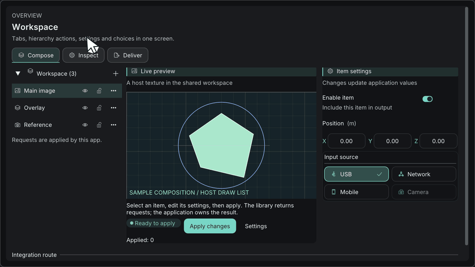

# 設定画面を作る

[English](build-settings-screen.md) · [目次](../目次.md) · [仕組みと設計](../getting-started/仕組みと設計思想.md)

設定画面は、アプリが持つ構造体と、ラベル付きの部品の列でできています。部品は構造体を読み書きし、ユーザーの操作を知らせます。変更をどう扱うかは、アプリのコードが決めます。このチュートリアルでは、トグル、コンボ、数値、テキスト、保存ボタンを持つパネルを作り、保存と通知まで扱います。部品ごとのリファレンスは、[基本コンポーネント](../components/基本コンポーネント.md)にあります。



## 基本の形

1. **状態は、アプリの構造体に置く。** 1つの構造体に、すべての設定を持たせます。ImKitは、それを保存しません。
2. **1つのラベル付きの行に、部品を1つ。** `BeginSettingRow`は、1列目にラベル、2列目に部品を描きます。
3. **パネルは、要求を返す。** ユーザーが保存を押すと、パネルはtrueを返します。検証、保存、通知は、アプリのコードが行います。

## 始める前に

Dear ImGuiのContextとウィンドウ（アプリ、またはGallery）、`Theme`、リンクした`imkit::imkit`が必要です。

## 手順1: 状態を定義する

```cpp
#include <imkit/imkit.h>
#include <array>

struct DisplaySettings {
    bool enabled = true;             // トグル
    int quality = 1;                 // 0〜2。コンボで選ぶ
    char qualitySearch[64]{};        // コンボの検索用バッファー。アプリが持つ
    float exposure = 0.0f;           // EV単位
    char name[128] = "Main display"; // テキスト入力
    bool showSavedNotice = false;    // 通知の表示を決める
};
```

`qualitySearch`は、コンボを描いている間は生かしておき、必要に応じて消去します。

## 手順2: 設定の行を使う

```cpp
// トグルは単独で完結するので、行は要らない。
imkit::Toggle("Enabled", &settings.enabled, {&theme});

// ほかの部品は、行の中に置く。
if (imkit::BeginSettingRow("exposure", "Exposure")) {
    imkit::DragFloatWithUnit("##exposure", &settings.exposure, "EV", 0.01f, -8.0f, 8.0f);
    imkit::EndSettingRow();   // BeginSettingRowがtrueを返したときだけ
}
```

- `BeginSettingRow(id, label, labelWidth)`は、ラベルと2列目を配置します。`id`は、Dear ImGuiの安定したIDです。
- 部品のidは`##`で始め、行の中でラベルが二重に表示されないようにします。
- `EndSettingRow`は、`BeginSettingRow`がtrueを返したときだけ呼びます。

## 手順3: パネルを組み立てる

`NewFrame()`と`Render()`の間で呼びます。

```cpp
bool DrawDisplaySettings(DisplaySettings& settings,
                         const imkit::Theme& theme, double now) {
    imkit::ThemeScope themeScope(theme);      // パネルはこのテーマで描き、終わると前のテーマに戻す
    bool saveRequested = false;

    if (imkit::Begin("Display settings")) {
        imkit::Toggle("Enabled", &settings.enabled, {&theme});

        if (imkit::BeginSettingRow("quality", "Quality")) {
            constexpr std::array<const char*, 3> labels{"Draft", "Balanced", "High"};
            imkit::SearchableCombo("##quality", &settings.quality, labels,
                                   settings.qualitySearch, sizeof(settings.qualitySearch));
            imkit::EndSettingRow();
        }

        if (imkit::BeginSettingRow("exposure", "Exposure")) {
            imkit::DragFloatWithUnit("##exposure", &settings.exposure, "EV", 0.01f, -8.0f, 8.0f);
            imkit::EndSettingRow();
        }

        imkit::InputTextWithHint("Name", "Required", settings.name, sizeof(settings.name));
        const bool invalidName = settings.name[0] == '\0';
        imkit::ValidationMessage("Enter a name before saving.", invalidName, &theme);
        imkit::BeginDisabled(invalidName);
        saveRequested = imkit::ActionButton("Save", imkit::ActionVariant::Primary,
                                            {}, {&theme});
        imkit::EndDisabled();

        if (settings.showSavedNotice &&
            imkit::NotificationCard({"saved", "Settings saved", imkit::StatusKind::Success, 0},
                                    now, &theme)) {
            settings.showSavedNotice = false;   // ユーザーが閉じた
        }
    }
    imkit::End();                                // Beginと必ず対にする
    return saveRequested;
}
```

入力の種類を変えるときは、`SearchableCombo`を`Segmented`（少数の固定の選択肢）に替えます。数値には`InputScalarWithUnit`や`DragVector3WithUnit`を使い、現在の状態を示すには`StatusBadge`を足します。

## 手順4: 検証、保存、通知

パネルは、何も保存しません。trueが返ったら、アプリのコードが処理します。

```cpp
const double now = ImGui::GetIO().Time;
if (DrawDisplaySettings(settings, theme, now)) {
    if (settings.name[0] == '\0') {
        return;                                // ボタンは無効だったが、念のため確認する
    }
    PersistDisplaySettings(settings);          // ファイル、データベース、通信などの保存処理
    settings.showSavedNotice = true;           // 次のフレームから表示される
}
```

| 段階 | 担当 |
| --- | --- |
| 検証 | `ValidationMessage`が文言を表示し、`BeginDisabled`が同じ条件で保存を止めます。条件は1か所にまとめます。 |
| 保存 | 保存ボタンが押されたあと、アプリのコードが行います。`showSavedNotice`は、保存に成功してから設定します。失敗したときに、成功の通知が出ないようにするためです。 |
| 通知 | ユーザーが閉じると、`NotificationCard`がtrueを返します。`expiresAt`が0なら、アプリが外すまでカードは残ります。 |

## 動かす

Galleryの設定画面も、同じ形で作られています。`imkit_gallery`ターゲットをビルドして、テーマが当たった状態を確認できます（[Galleryガイド](../getting-started/ギャラリーガイド.md)を参照）。自分のアプリでは、フレームの中で`DrawDisplaySettings`を呼び、返った要求を上の例のように処理します。

## 守る規則

- 1つの設定は、1つのフィールドだけに置き、部品がそれに書き込みます。
- 1つの行には、部品を1つだけ置きます。ラベルと2つの部品を、1行に詰めません。
- 入力が不正な間は、操作を無効にし、メッセージを入力欄の近くに表示します。
- 部品は、ファイルや通信を開きません。パネルが返し、アプリが動きます。
- `Begin`と`End`は常に対にします。`BeginSettingRow`と`EndSettingRow`は、trueを返したときだけ対にします。

## 次に読む

- [基本コンポーネント](../components/基本コンポーネント.md): 部品ごとの詳細です。
- [ノードエディタを作る](ノードエディタの作成.md)
- [カスタムコンポーネントを作る](カスタムコンポーネントの作成.md)
