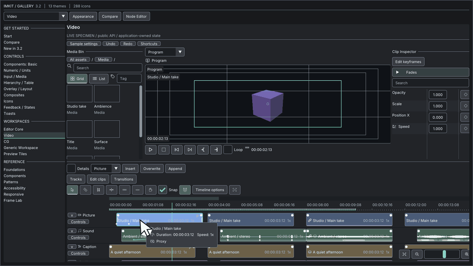

## Use this when

Choose Editor Core, Video or CG surfaces when a production tool needs editing controls over data and resources already owned by its application.

## Gallery capture



Editor Suite — timeline and editing surfaces · [Open the native Gallery animation](https://raw.githubusercontent.com/AokiMotohide/imgui-modern-kit/main/docs/images/v3-timeline.gif)

## Minimum drawing example

```cpp
#include <imkit/video.h>
#include <imkit/editor_core.h>

void DrawTimeline(const imkit::video::TimelineProvider& provider,
                  imkit::video::TimelineState& state,
                  imkit::editor::Selection& selection,
                  imkit::editor::EventBuffer& events,
                  const imkit::Theme& theme) {
    imkit::video::Timeline("timeline", provider, state, selection, events, theme);
}
```

**Example type:** Host-state function excerpt. The application supplies provider, selection, event storage and Theme, then validates and applies events.

## Integrate with the application

Link `imkit::editor_suite` or the narrower `imkit::video` target and keep every provider span valid during the call.

## Scope

The editing surfaces do not decode or play media, render arbitrary 3D scenes, own undo or load project files.

## Related API and guides

- [Editor API contracts](../../api/editor-suite/)
- [Timeline editing guide](../timeline/)

---

ImKit's Editor Suite provides professional UI components built on the pinned Dear ImGui 1.93.0 WIP docking commit, tailored for creative applications such as DCC tools, video editors, and audio sequencers.

For clip fade curves, cut transitions, and track gestures, see [Timeline Editing](../timeline/).

---

## Modules

| Target | Header | Role |
|---|---|---|
| `imkit::imkit` | `<imkit/imkit.h>` | Native wrappers, Precision Layers theme, and core icon support |
| `imkit::editor_core` | `<imkit/editor_core.h>` | Infinite canvas, time ruler, curve editor, property grid, and asset browser |
| `imkit::video` | `<imkit/video.h>` | Multi-track timeline, video monitor overlays, audio mixer, and color controls |
| `imkit::cg` | `<imkit/cg.h>`<br>`<imkit/preview.h>` | 3D viewport gizmos, scene hierarchy, animation dope sheet, and UV editor |
| `imkit::editor_suite` | Module headers above | Complete suite aggregate: Core + Video + CG (OpenGL optional) |
| `imkit::preview_opengl3` | `<imkit/preview.h>` | Optional offscreen GPU preview renderer using host OpenGL 3.3 context |

---

## Ownership and events

- **Host Ownership**: The host application owns the Dear ImGui Context, backend, fonts, textures, project source data, providers, UI state, selection, undo/redo history, persistence, and worker threads.
- **Data Borrowing**: Spans and UTF-8 label pointers are borrowed strictly for the duration of each call.
- **Identifiers & Time Precision**:
  - `StableId` is a unique, non-zero `uint64_t`.
  - Time is managed in integer `Tick` units at 705,600,000 ticks/second (`int64_t`) with a rational `FrameRate`.
  - Supports negative pre-roll, drop-frame timecodes (29.97 / 59.94 fps), and two-digit hour fields.
- **Preview Component Scope**: Layout, overlays, input handling, and user interaction requests only. Image/video decoding, media streaming, CG rendering, device contexts, and window management remain host-owned. The Video Monitor displays host-supplied textures and states for the current frame without seeking or playing media directly.
- **Continuous Gestures & Transactions**:
  - Continuous edits emit `Begin / Update / Commit / Cancel` phases with revision counters, original values, and proposed values.
  - Drafts are previewed separately; revisions increment on accepted commits or external changes, cancelling stale gestures.
  - Fixed-capacity event and scratch buffers report overflow without implicit heap allocations.
- **Query Bounding**: Visible providers bound per-frame processing; detailed selected-member and neighbor queries execute only when actively required for editing.

---

## Editor controls

### 1. Editor Core
- **Infinite Canvas**: Smooth pan, zoom, fit, and box/lasso selection.
- **Time & Transport**: Frame-accurate time ruler, editable ranges, marker edits, and configurable transport controls.
- **Curve Editing**: Multi-key Bezier curves, adjustable handles, extrapolation modes, and frame snapping.
- **Inspector & Assets**: Property states, array reordering, numeric copy/paste, and filtered asset grid/list views with inline renaming.

### 2. Video Editor
- **Multi-Track Timeline**: Variable-height role tracks, linked clip move/trim, split, ripple, roll, slip, slide, and ripple-delete operations.
- **Snapping & Alignment**: Magnet snapping to playhead, markers, clip boundaries, and frame grids.
- **Audio & Scopes**: PCM bucket caching, envelope/mixer controls, CPU-based RGB/luma/vectorscopes, and three-way color wheels.


### 3. CG Editor
- **3D Viewport**: Orbit, Pan, and Zoom navigation with camera/lighting framing guides, safe frames, and passepartout.
- **Affine Transform Gizmos**: Multi-object transform gizmos supporting translation, rotation, oriented non-uniform scaling, and affine shear via QR decomposition.
- **Scene Hierarchy**: Outliner supporting component/modifier rows, drag-and-drop reparenting, and state filtering.
- **UV Editor**: Vertex, edge, face, and island selection/transforms with normalized, pixel, and UDIM coordinate systems.


---

## Preview lifecycle

- **DrawList Preview**: Projects unowned indexed mesh spans into host scratch buffers with depth sorting. Includes cube, sphere, camera, and light primitives. Intersection and occluded silhouettes are approximate due to the absence of a hardware Z-buffer.
- **OpenGL 3.3 Renderer**: Manages its own FBO, color, depth, and pick textures.
  - The host supplies `GLFunctions` and an active OpenGL 3.3 context for `Init`, `Resize`, `Render`, `Pick`, and `Shutdown`.
  - Always call `Shutdown()` before destroying the OpenGL context.
  - The host is responsible for restoring OpenGL pipeline state (blend, depth, viewport, scissor) after rendering.

---

## Native Gallery

The companion Gallery application demonstrates Core, Video, and CG editor modules in action:

```powershell
cmake --build --preset windows-debug --target imkit_gallery --parallel
./build/windows-debug/catalog/Debug/imkit_gallery.exe
```

- **Stress Testing**: The 100k toggle benchmarks performance with 256 tracks, 100,096 clips, and 100,000 keys.
- **Display Selection**: `--list-monitors` and `--monitor N` allow targeting specific displays in multi-monitor setups without altering OS display configurations.
- **Interaction Demonstrations**: Includes transition history undo/redo, custom shortcut rebinding, and 288-icon atlas integration.

---

## Scope

- For the graph and workflow companion module, see [Node Editor](https://github.com/AokiMotohide/imgui-modern-kit/blob/main/docs/components/node-editor.md).
- ImKit provides immediate-mode UI controls; it is **not** a media decoder, audio resampler, color management pipeline, UV unwrapper, physics engine, or 3D asset file loader.
- Historical validation records and interaction design notes are preserved in [Validation Records](https://github.com/AokiMotohide/imgui-modern-kit/blob/main/docs/archive/editor-validation.md) and [Editor Refresh Design](https://github.com/AokiMotohide/imgui-modern-kit/blob/main/docs/archive/editor-refresh.md).
